# Cómo se construye una empresa que escala

**Lo que Ford, Toyota, Apple, Amazon y SpaceX resolvieron con lápiz, y cualquiera puede rehacer: cinco cuentas, doce recetas y veintiséis lecciones de otras industrias.**

**Qué es:** un manual de principios, cuentas y recetas para diseñar, producir, vender y financiar un negocio que pueda crecer. Toma cinco empresas que cambiaron industrias enteras y separa lo que se puede copiar de lo que no.

**Para quién:** quien tiene o quiere tener un negocio —un taller, un servicio, una fábrica, un comercio, un producto digital— y quiere saber si puede crecer y cómo. También para quien lo enseña.

**Qué no es:** ni una biografía ni una promesa. Ninguna receta garantiza el resultado de las empresas que se citan: mejoran el costo, la calidad y las probabilidades. La Parte 8 explica por qué, con números.

**Versión:** 2.0 · octubre de 2026 · las 91 afirmaciones de la versión 1.1 están auditadas contra fuentes, con su estado; las fichas de la Parte 11 se verificaron en octubre de 2026 · todavía sin verificar con lectores (la prueba de salida está en la Parte 12).

<p class="legal">© 2026 Pablo L. Rainieri Blasco · Licencia Creative Commons Atribución 4.0 Internacional (CC BY 4.0) · Se puede copiar, adaptar y redistribuir citando al autor. Detalles en el colofón.</p>

---

## ANTES DE EMPEZAR: CUATRO ACERTIJOS

Este libro está armado alrededor de una idea que se puede comprobar en uno mismo: **lo que se intenta responder antes de leer la respuesta se recuerda mucho mejor**, aunque el intento salga mal (Kornell, Hays y Bjork 2009; Richland, Kornell y Kao 2009). Por eso cada parte empieza con un acertijo. Conviene anotar la respuesta en un papel, con un número, antes de seguir. La distancia entre lo que se anotó y lo que dice el libro es exactamente lo que el libro enseña.

Cuatro para empezar. Sus respuestas están repartidas en el libro, y casi nadie acierta las cuatro:

1. **El costo.** Una fábrica quiere que su producto cueste la décima parte de lo que cuesta hoy. ¿Cuántas veces tiene que multiplicar la producción acumulada? ¿Diez? ¿Cien? ¿Mil? *(§3.3)*
2. **La moneda.** Mil personas apuestan todo su dinero, diez veces seguidas, a una moneda que sale a favor el 60 % de las veces y paga lo apostado. ¿Cuántas siguen en juego después de la décima tirada? *(§8.2)*
3. **El cohete.** Con los mismos datos técnicos, ¿cuánto puede cambiar el costo de desarrollar un cohete sólo por el tipo de contrato con que se encarga? ¿Un 10 %? ¿El doble? *(§2.5)*
4. **El tiempo.** Un millón de segundos son once días y medio. ¿Cuánto son mil millones de segundos? *(§5.4)*

---

## CÓMO USAR ESTE LIBRO

**Tres formas de leerlo:**

| Si se tiene… | Leer | Se sale con |
|---|---|---|
| Una hora | El mapa, los 12 principios, la Parte 3 y la Parte 8 | Las cinco cuentas que deciden si algo puede crecer, y por qué el resultado no está garantizado |
| Un fin de semana | Todo, de corrido, con lápiz | El método completo, y la prueba de salida para comprobarlo |
| Un negocio entre manos | El mapa, la Parte 10 y después cada parte que la Parte 10 señale | Un plan con peldaños, controles y condiciones de abandono |

**Los 12 principios** son para memorizar. Con ellos solos se evitan las formas más caras de fracasar al crecer: escalar un margen negativo, automatizar un paso que había que borrar, tener un producto excelente que nadie sabe vender, y financiar la etapa siguiente con el dinero que hacía falta para sobrevivir a la actual.

**Las Partes 1 a 3 son el esqueleto:** la empresa como producto de funciones, cinco casos comparados y las cinco cuentas. Se leen una vez con lápiz y después se consultan.

**La Parte 4 es el recetario:** doce procedimientos con ingredientes, pasos y criterio para saber si salió bien.

**Las Partes 5 a 10 son operación:** cómo ver una magnitud, los controles antes de cada etapa, los errores que se repiten, por qué hay tan pocos casos, hojas por tipo de negocio y el protocolo para convertir una idea en una escalera.

**La Parte 11 sale de otras industrias:** veintiséis lecciones de la aviación, la defensa, la medicina, la informática y la logística, cada una con su caso, su número, su fuente y **cuándo falla**. La Parte 12 es la prueba de salida.

**Cómo se marcan los datos.** Cada número lleva su estado: `[reportado]` viene de biografías, prensa o informes de la empresa; `[cálculo]` es aritmética que el lector puede rehacer; `[objetivo declarado]` es una meta que todavía no se cumplió; `[interpretación]` es una lectura de los hechos que otros podrían discutir; `[hipótesis]` es una idea de este manual que la investigación todavía no confirmó. El Anexo A lista los números con su fuente y dice cuáles se contrastaron con la fuente original.

---

## QUÉ EVIDENCIA HAY DETRÁS, Y QUÉ NO

**Los principios se apoyan en investigación publicada,** no en los casos. El Anexo B la ordena por campo: gestión de operaciones, historia empresarial, economía industrial y de la innovación, estrategia y dinámica de sistemas.

**Los cinco casos son ilustraciones elegidas por su claridad, no una muestra.** Muestran cómo funciona un mecanismo; no prueban que funcione (Siggelkow 2007).

**Este género tiene un defecto conocido: sacar principios de empresas exitosas.** Denrell (2003) muestra que aprender sólo de los sobrevivientes hace parecer buenas prácticas que en realidad son riesgosas. Rosenzweig (2007) documenta el «efecto halo»: al que le va bien se le atribuyen virtudes a posteriori. Y de las once empresas elogiadas en *Good to Great* (Collins 2001), en los años siguientes sólo una siguió superando al mercado según la medida del propio libro, y ninguna según una medida financiera estándar (Resnick y Smunt 2008). Por eso este manual pone cada caso al lado de su fracaso, cada principio al lado de su fuente, y marca como `[hipótesis]` lo que es idea propia.

**Lo que este manual no permite concluir:** que aplicar las recetas produzca el resultado de estas empresas, ni cuánto aporta cada principio por separado.

El error que este manual quiere evitar no es soñar demasiado grande. Es el opuesto, y es más frecuente: **tener el sueño grande y no tener la escalera**, y confundir esa ausencia con falta de dinero o de suerte. Casi siempre falta una cuenta de tres renglones que nadie hizo.

---

## LA TESIS: EL MÉTODO NO ES DE LA PERSONA

Los nombres famosos quedan pegados a métodos que a menudo tienen otros autores, anteriores y públicos:

| Método | Quién lo hizo famoso | Quién lo formuló (o lo usó antes) |
|---|---|---|
| El costo baja con cada duplicación del volumen | Ford, Tesla | T. P. Wright, fábricas de aviones, 1936 |
| Costo por primeros principios (cuánto vale el material contra cuánto se paga) | SpaceX | Lawrence Miles, análisis de valor, General Electric, 1947 |
| Fijar el costo antes de diseñar, y diseñar para llegar a él (costeo objetivo) | SpaceX: «el presupuesto es de cinco mil dólares» (Vance 2015) | Toyota y otras automotrices japonesas; lo documentaron Robin Cooper y Regine Slagmulder, 1997 |
| La mejor pieza es la que no existe | Musk: «la mejor pieza es ninguna pieza» (citado por Tim Dodd, 2019) | Geoffrey Boothroyd y Peter Dewhurst, diseño para el ensamblaje, desde 1977: tres preguntas para decidir si cada pieza tiene que existir |
| Un equipo chico, aislado y con autoridad para decidir | — | Kelly Johnson, Skunk Works de Lockheed, 1943: el XP-80 se diseñó y construyó en 143 días, y el contrato llegó cuatro meses después de empezar |
| La línea de montaje móvil | Ford, 1913 | Los frigoríficos de Chicago, que desmontaban reses en línea, según Ford (1922); Hounshell (1984) documenta otras influencias |
| Invertir a la vez en producción, distribución y administración | Las grandes industriales del siglo XX | Alfred Chandler, historia empresarial, 1990 |
| La calidad se construye en el proceso | Toyota | Walter Shewhart (control estadístico, 1931); Sakichi Toyoda (telar que se detiene solo, 1924); W. Edwards Deming (lo llevó a Japón desde 1950); Taiichi Ohno |
| Entender al cliente, enfocarse y cuidar la presentación | Apple, Steve Jobs | Mike Markkula, «La filosofía de marketing de Apple», hacia 1977 |
| Una gama de productos para cada bolsillo | General Motors | Alfred Sloan, en los años veinte — el que le ganó a Ford |
| El volante que gira solo | Amazon | Jim Collins, que lo trabajó con Amazon desde 2001 (Collins 2019) |
| No apostar la supervivencia | — | J. L. Kelly, 1956 |
| El cuello de botella decide el ritmo de todo el sistema | — | Eliyahu Goldratt, 1984 |

Esto trae una buena noticia y una mala. **La buena: los métodos son públicos y se pueden aprender.** Ninguno de este manual es secreto. **La mala: el resultado no depende sólo del método.** Depende también de factores que la persona no controla —el capital inicial, el momento del mercado, sobrevivir a eventos de todo o nada— y que se multiplican entre sí (Parte 8). Por eso este manual no ofrece la magnitud del resultado; ofrece la **pendiente**: cuánto mejora un negocio por cada ciclo de trabajo.

**Por qué entonces hay tan pocas empresas así, si el método es público.** La hipótesis de este manual `[hipótesis]` —nadie la midió todavía— es que los conceptos se transmiten muy desigual:

| Nivel | Concepto | Cuánto cuesta entenderlo | Se transmite por | Quién lo tiene |
|--|--------|--------|--------|-----|
| 1 | Reutilizar en vez de tirar | Muy poco: se ve en un dibujo | video, anécdota, foto | casi todos |
| 2 | Margen por unidad | Poco: es una resta | conversación, ejemplo | muchos |
| 3 | Curva de aprendizaje por duplicación | **Mucho: hace falta lápiz** | sólo texto y cuenta propia | poquísimos |
| 4 | Lazo realimentado y su ganancia | **Mucho: hace falta un modelo** | sólo texto y cuenta propia | poquísimos |
| 5 | Capital, tiempo y riesgo de ruina | **Mucho, y además es desagradable** | sólo texto y cuenta propia | poquísimos |

Los niveles 1 y 2 son visuales y parecen propagarse solos: todo el mundo entiende «reutilizar el cohete». Los niveles 3 a 5 se parecen a la tarea de matemática y no se transmiten por video. **La hipótesis:** una parte de la escasez de gente que construye empresas grandes no sería falta de ambición, sino una falla de transmisión en los niveles 3 a 5. La investigación sobre aprendizaje con imagen y texto (Mayer 2009) es compatible con esta idea, pero no la prueba. El método del manual se apoya en ella: atar cada concepto difícil a un objeto que se pueda ver. Por eso este libro tiene cuarenta y tres figuras: la curva de aprendizaje se ve como una escalera, el lazo como un volante que arranca o no arranca, y el capital como un pozo con fondo medible.

---

## EL MAPA: EL LIBRO ENTERO EN UNA FIGURA

<div class="acertijo">

**El acertijo.** SpaceX construye su cohete más grande con acero inoxidable, el material de las ollas, y no con la fibra de carbono de los aviones modernos. ¿Capricho, ahorro o algo más? Anotar una respuesta; está en §2.5.

</div>

Todo el libro es una misma pregunta —*¿esto puede crecer?*— hecha cinco veces, con una herramienta más cada vez:

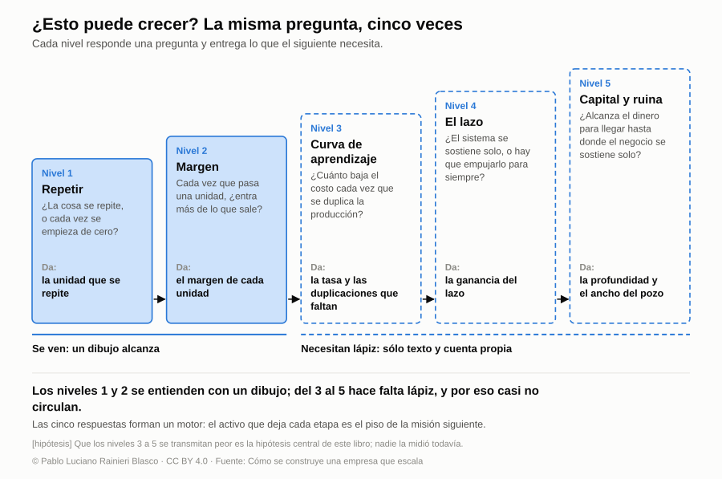

Y las cinco respuestas forman un motor que se realimenta:

1. **La misión**, en una línea, con el número final que la haría posible (un precio, un costo por unidad, una cantidad por mes).
2. **La unidad** que se repite: ¿qué se repite?
3. **El margen** de cada unidad: ¿entra más de lo que sale?
4. **Las duplicaciones** que faltan hasta el número final, y cuánto cuesta cada una.
5. **El activo** que queda instalado al terminar cada etapa.
6. **La plataforma:** ese activo se vuelve el piso desde el que arranca una misión nueva, que antes era imposible. Y el motor vuelve a girar.

**El punto es la recursión. No se escala un proyecto: se escala una posición**, desde la cual el proyecto siguiente arranca más barato. El Falcon 1 no era un negocio: era la posición desde la cual arrancó el Falcon 9. El Falcon 9 financia el Starship y hace posible Starlink, que a su vez es la carga que justifica la escala del Starship. Lo mismo vale para un taller: el primer molde no es un producto, es la posición desde la cual el segundo producto sale más barato.

**Tres advertencias antes de seguir:**

- **No todo tiene que escalar.** Un estudio profesional, un consultorio o una carpintería de autor pueden ser excelentes negocios que no escalan, y forzarlos a escalar los destruye. «¿Esto escala?» es un filtro, no un juicio de valor. El error no es tener un negocio que no escala: es tener uno que no escala y una expectativa de crecimiento que sólo tendría sentido si escalara.
- **El motor tiene retardo.** Entre que baja el costo y que la demanda responde pasan meses. Un lazo con retardo largo y poca caja puede chocar contra la pared antes de cobrar (§3.5).
- **Cada duplicación cambia el cuello de botella.** No es la misma empresa la que factura diez mil que la que factura cien mil. Lo que mata cambia en cada orden de magnitud (§5.2).

---

## LOS 12 PRINCIPIOS

1. **La empresa es un producto de funciones, no una suma de talentos.** Si una función vale cero —entender al cliente, diseñar, producir, vender, financiar, organizar— el resultado vale cero, por excelentes que sean las otras. *(Apple, 1977: hicieron falta tres personas.)*
2. **Se diseña hacia atrás, desde el número final.** El número que hace posible la misión se propaga hasta la decisión de mañana. *Prueba:* si cambiar el objetivo final no cambia lo que se hace el lunes, no se está diseñando para la misión. *(Ford: un auto que un obrero pudiera pagar. SpaceX: el costo por kilo.)*
3. **Escalar es encontrar la unidad que se repite.** Si no se puede nombrar en una palabra —un auto, un pedido, un lanzamiento, una instalación— no hay un proyecto escalable: hay un encargo.
4. **El volumen multiplica el signo del margen.** Margen por unidad negativo más volumen es ruina más rápida. La única excepción legítima es una curva de aprendizaje **medida**: que el costo ya haya bajado al menos una vez con datos propios.
5. **El costo baja por duplicaciones acumuladas, y la curva se paga dos veces:** con rediseño en cada duplicación y con rigidez. *(Ford bajó el precio del Modelo T durante quince años, y cambiarlo le costó seis meses de fábrica parada.)*
6. **La calidad se construye en el proceso, no se inspecciona al final.** Un defecto encontrado en la línea cuesta mucho menos que el mismo defecto encontrado por el cliente. *(Toyota.)*
7. **Borrar antes que optimizar, y automatizar último,** en el producto y en el proceso. Automatizar un paso que no debería existir lo vuelve invisible. *(Apple en 1997 borró el 70 % de sus productos; Toyota automatiza después de estabilizar.)*
8. **El cliente paga lo que percibe.** La calidad que no se ve hay que volverla visible: con simplicidad, presentación y garantía. *(Apple: «la gente sí juzga un libro por la tapa». Toyota: confiabilidad como marca.)*
9. **Cada etapa vende algo hoy y deja instalado un activo que abarata la siguiente.** Si sólo vende, es un negocio —válido— pero no una escalera. Si sólo abarata, es un pozo.
10. **El crecimiento se financia primero con el cliente y después con el capital.** Cobrar antes de pagar financia sin pagar interés explícito. *(Amazon.)*
11. **Nunca se apuesta la supervivencia.** El dinero para llegar a la etapa siguiente nunca es el mismo que hace falta para sobrevivir a la actual.
12. **Los mecanismos se copian; los rasgos y el resultado, no.** Los plazos imposibles anunciados en público, la dureza con la gente, la apuesta total, son costos que sólo una posición dominante absorbe. Lo que se copia es el mecanismo.

---

## PARTE 1 — LA EMPRESA ES UN PRODUCTO DE FUNCIONES

<div class="acertijo">

**El acertijo.** En 1976 un ingeniero diseña una de las mejores computadoras personales de su época, con muy pocos componentes. ¿Qué le falta para tener una empresa? Nombrar todo lo que falte; está en §1.2.

</div>

### 1.1 Las seis funciones

Es una simplificación para enseñar, no una clasificación establecida. Chandler (1990) mostró que las empresas que dominaron sus industrias en Estados Unidos, Gran Bretaña y Alemania invirtieron a la vez en tres frentes: producción, distribución y administración. Porter (1985) divide la actividad de una empresa en los nueve eslabones de su cadena de valor. Las seis funciones de este manual agrupan esas categorías en preguntas que se pueden contestar con un dato `[hipótesis: agrupación didáctica]`:

| # | Función | La pregunta | Qué pasa si vale cero |
|-|--------|--------------------|--------------|
| 1 | **Entender al cliente** | ¿Qué problema resuelve, para quién, y qué usa hoy en su lugar? | Un producto excelente que nadie pidió |
| 2 | **Definir el producto** | ¿Qué hace, y sobre todo qué **no** hace? | Un producto que hace todo a medias |
| 3 | **Producir con calidad** | ¿Cada unidad sale igual y bien, a un costo que baja? | Cada venta es una apuesta |
| 4 | **Vender y distribuir** | ¿Cómo llega al cliente, y por qué le cree? | El mejor producto del taller, sin salir del taller |
| 5 | **Financiar y sobrevivir** | ¿Alcanza la caja hasta que el negocio se sostenga solo? | Tener razón en todo y cerrar igual |
| 6 | **Organizar y aprender** | ¿Funciona sin el fundador, y mejora en cada ciclo? | El techo del negocio son las horas de una persona |

**Por qué es un producto y no una suma.** En una suma, lo que sobra de una parte compensa lo que falta de otra. En un producto, no: `resultado ≈ f₁ × f₂ × f₃ × f₄ × f₅ × f₆`, y si un factor vale cero, todo vale cero. Por eso un ingeniero brillante sin nadie que venda no tiene una empresa, y un vendedor brillante sin producto tiene una promesa que se va a romper. Es un supuesto de modelo, con antecedentes: Kremer (1993) formalizó la producción en la que una sola tarea mal hecha arruina el conjunto, y la bautizó por la junta tórica que causó el accidente del transbordador Challenger. Y es la idea que Goldratt llamó *teoría de las restricciones*: **el sistema avanza al ritmo de su parte más débil**, y mejorar cualquier otra no mueve el resultado.

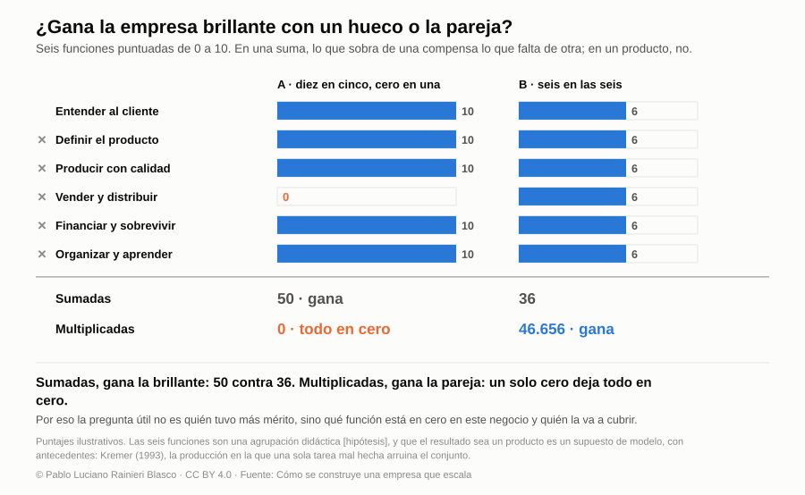

### 1.2 El caso que lo demuestra: Apple, 1976-1977

Apple no la hizo funcionar una sola persona. La hicieron funcionar tres, que cubrían funciones distintas `[reportado — Isaacson 2011; Wozniak 2006]`:

- **Steve Wozniak — el producto técnico.** Diseñó la Apple I y la Apple II con muy pocos componentes, algo que otros ingenieros admiraban. Y tomó una decisión técnica con enorme efecto comercial: según su propio testimonio, insistió en que la Apple II tuviera **ocho ranuras de expansión** cuando Jobs quería dos. Las ranuras permitieron que otras empresas le agregaran funciones a la máquina.
- **Steve Jobs — la definición del producto y la venta.** Donde Wozniak veía una placa para aficionados, Jobs vio un producto: vendió cincuenta Apple I a una tienda de computadoras y empujó para que la Apple II fuera una máquina terminada, con gabinete, simple de usar y bien presentada.
- **Mike Markkula — el capital y el método comercial.** Ex gerente de marketing de Intel. Puso US$250.000 —80.000 como capital y 170.000 como préstamo— a cambio de un tercio de la empresa, escribió el plan de negocios y redactó la filosofía de marketing de la empresa en tres palabras: **empatía** (entender las necesidades del cliente mejor que nadie), **foco** (eliminar las oportunidades que no importan) e **imputar** («la gente sí juzga un libro por la tapa»: la presentación comunica la calidad) `[reportado — documento en el archivo de Steve Jobs]`.

**La pregunta de quién tuvo más mérito no tiene respuesta en un producto,** igual que no la tiene preguntar qué lado de un rectángulo aporta más superficie: si cualquiera de los dos vale cero, la superficie es cero. La pregunta útil es operativa: **¿qué función está en cero en este negocio, y quién la va a cubrir?**

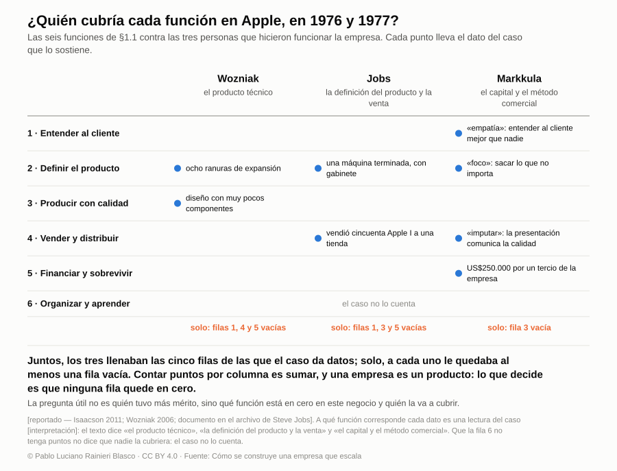

Y el caso enseña algo más, en las dos direcciones:

- **Para la persona técnica:** lo técnico solo no alcanza. La salida no es convertirse en otra persona, sino garantizar que ninguna de las seis funciones quede en cero: aprenderla, asociarse o contratarla. Jobs adoptó como propia la filosofía comercial que Markkula dejó por escrito `[reportado — Isaacson 2011]`. Se aprende.
- **Para la persona comercial:** la presentación sin producto también fracasa. El mismo Jobs lanzó la Lisa en 1983 a US$9.995 —un producto adelantado, a un precio que el mercado no pagaba— y en 1985 fue desplazado de su propia empresa `[reportado]`. Cuando volvió, en 1997, volvió con foco.

### 1.3 La prueba de las seis funciones

Una tabla de seis renglones, escrita hoy:

```
FUNCIÓN              RESPONSABLE (un nombre)   EVIDENCIA DE QUE NO VALE CERO (un dato)
1 Entender cliente   ______________________    ________________________________________
2 Definir producto   ______________________    ________________________________________
3 Producir           ______________________    ________________________________________
4 Vender             ______________________    ________________________________________
5 Financiar          ______________________    ________________________________________
6 Organizar          ______________________    ________________________________________
```

**Regla:** el renglón sin nombre o sin dato es el cuello de botella, y es ahí donde va el próximo peso y la próxima hora. Mejorar un renglón que ya está bien mientras otro está en cero es la forma más cómoda de no avanzar.

---

## PARTE 2 — CINCO EMPRESAS, CINCO LECCIONES

<div class="acertijo">

**El acertijo.** Las cinco empresas de esta parte tienen en común algo que casi nunca se cuenta cuando se las pone como ejemplo. ¿Qué es? Está en §2.6.

</div>

Cada caso sigue la misma estructura para poder compararlos: **el problema, el mecanismo, el número, dónde falló y qué se copia a escala pequeña.** El fracaso va al lado del éxito a propósito: una lección sin su contraejemplo es propaganda.

### 2.1 Ford — flujo, precio objetivo y el costo de la rigidez

**El problema.** A principios del siglo XX el auto era un juguete caro. El objetivo de Ford era un auto que pudiera pagar un obrero: un **precio final** que se propagó hacia atrás hasta el diseño de la fábrica.

**El mecanismo.** Un solo modelo (el Modelo T, 1908), piezas estandarizadas e intercambiables y, desde 1913, la **línea de montaje móvil**: el armado del chasis pasó de 12 horas y media a 93 minutos `[reportado — Hounshell 1984]`. La idea, según el propio Ford, la tomó de los frigoríficos de Chicago, que desmontaban reses colgadas de un riel; la historia académica de la línea documenta además otras influencias (Hounshell 1984).

La cadena, de arriba hacia abajo:

1. **Precio objetivo:** un auto que pueda pagar un obrero.
2. **Un solo modelo:** sin variedad, porque la variedad cuesta.
3. **Piezas iguales:** intercambiables; cualquiera arma cualquiera.
4. **Flujo:** la pieza viaja hacia la persona, no al revés.

**El número.** El precio del Modelo T bajó de US$850 en 1908 a US$260 a mediados de los años veinte (la versión más barata), y se fabricaron unos 15 millones `[reportado]`.

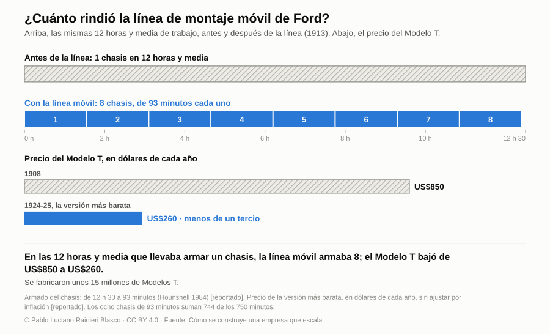

**El mito del jornal de cinco dólares.** En enero de 1914 Ford subió el salario básico de US$2,34 a US$5 por día. La versión popular dice que lo hizo para que sus obreros pudieran comprar autos. El dato que explica la decisión es otro: en 1913, el año de la línea móvil, la rotación de personal fue de alrededor del **370 %**: la empresa contrató a 50.448 personas para sostener una plantilla media de 13.623 `[reportado — Raff y Summers 1987; archivo de The Henry Ford]`. El salario alto fue el precio de retener gente en un trabajo muy duro. **Una compensación mide el costo de lo que compensa; no prueba que fuera bueno.**

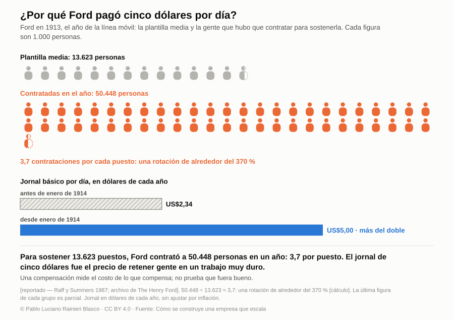

**Dónde falló.** La curva de aprendizaje compró costo al precio de la rigidez. Ford mantuvo un único modelo mientras General Motors, con Alfred Sloan, ofrecía «un auto para cada bolsillo y cada propósito», cambio anual de modelo y venta a crédito. En mayo de 1927 Ford paró la producción unos seis meses para pasar al Modelo A, y ese año Chevrolet vendió más del doble que Ford `[reportado]`. Abernathy y Wayne (1974) usan este caso para mostrar el límite de la curva de aprendizaje. Antes de todo esto, además, las dos primeras empresas de autos de Henry Ford habían fracasado (1899-1902).

**Qué se copia a escala pequeña:** elegir una unidad, estandarizarla, medir el tiempo por unidad y diseñar hacia atrás desde el precio que el cliente puede pagar. **Qué no:** casarse con un diseño para siempre.

### 2.2 Toyota — la calidad se hace en el proceso

**El problema.** El Japón de posguerra tenía un mercado chico, poco capital y demanda de muchos modelos en poco volumen. La producción en masa de Ford no servía: había que ser eficiente **sin** escala.

**El mecanismo.** El Sistema de Producción Toyota, formulado sobre todo por Taiichi Ohno, se apoya en dos pilares:

- **Justo a tiempo:** producir sólo lo que se necesita, cuando se necesita. El inventario no es un colchón: es lo que esconde los problemas.
- **Autonomatización (*jidoka*):** la máquina o la persona se detiene sola cuando algo sale mal. El origen es el telar automático de Sakichi Toyoda (1924), que paraba cuando se cortaba un hilo. En la línea se materializa en el **cordón andon**: cualquier operario puede detener la línea.

Y tres prácticas: **mejora continua** hecha por quienes hacen el trabajo; **los cinco porqués** para llegar a la causa raíz; y **los siete desperdicios** (sobreproducción, espera, transporte, procesos de más, inventario, movimientos, defectos). Deming, que dio conferencias en Japón desde 1950, llevó allí el control estadístico de la calidad que Walter Shewhart había desarrollado en Estados Unidos.

Un detalle que ilustra el principio 9: en diciembre de 1929 Sakichi Toyoda vendió a la empresa inglesa Platt Brothers los derechos del telar fuera de Japón, China y Estados Unidos por 100.000 libras, y ese dinero fue capital semilla del negocio de autos `[reportado — historia oficial de Toyota]`. **El activo de una etapa financió la siguiente.**

**El número: NUMMI.** En 1982 General Motors cerró su planta de Fremont (California): tenía más de 700 reclamos gremiales pendientes, un ausentismo cercano al 20-25 % y una de las peores calidades de la empresa. En 1984 reabrió como empresa conjunta con Toyota, con **alrededor del 85 % de los mismos trabajadores**, bajo el sistema Toyota. En un año la calidad pasó a estar entre las mejores de General Motors y el ausentismo bajó a cerca del 2 % `[reportado — Lean Enterprise Institute; Adler 1993; Krafcik 1988]`. Misma gente, otro sistema. Y General Motors tuvo ese ejemplo adentro durante 25 años sin lograr replicarlo en el resto de sus plantas `[reportado — Shook 2010]`: **transmitir un método puede fallar incluso dentro de una misma organización.** La planta cerró en 2010 y ese mismo año la compró Tesla.

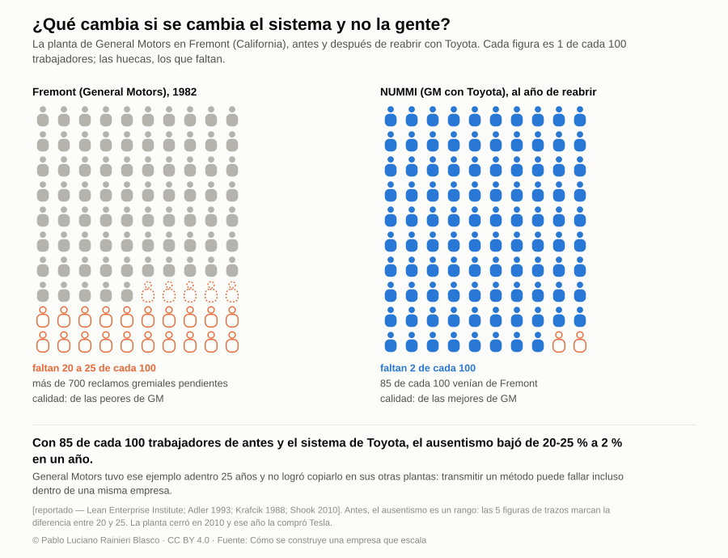

**Calidad, precio y garantía.** Cada defecto evitado en la línea es un costo que no se paga en reparación, en garantía ni en reputación. Por eso la calidad bien hecha **baja** el costo en vez de subirlo, y la confiabilidad se vuelve la marca.

**Dónde falló.** En 2009 y 2010 Toyota llamó a revisión millones de vehículos por problemas del acelerador. Ante el Congreso de Estados Unidos, el 24 de febrero de 2010, su presidente declaró: «temo que el ritmo al que crecimos haya sido demasiado rápido» `[testimonio publicado por Toyota]`. **Crecer más rápido que el sistema de calidad es violar el principio que había hecho crecer.**

**Qué se copia a escala pequeña:** la regla de detener el trabajo ante un defecto, los cinco porqués en cada falla, medir cuántas unidades salen bien a la primera, y bajar el inventario para ver los problemas. **Qué no:** repetir el vocabulario japonés como ritual sin darle a nadie el derecho de parar.

### 2.3 Apple — producto, foco y lo que el cliente percibe

**El problema.** En 1976 las computadoras personales eran kits para aficionados. En 1997, el problema era otro: una empresa con demasiados productos, perdiendo dinero.

**El mecanismo.**

- **Producto terminado e integrado:** el aparato y su programa se diseñan juntos, para que el usuario no tenga que armar nada.
- **Foco:** al volver en 1997, Jobs redujo la línea de productos alrededor de un 70 % y la ordenó en una cuadrícula de cuatro: consumidor o profesional, escritorio o portátil `[reportado — Isaacson 2011]`. Apple había perdido US$1.045 millones en el ejercicio de 1997; en 1998 ganó US$309 millones `[reportado — informes anuales de Apple]`.
- **Presentación:** el embalaje, el diseño y, desde 2001, las tiendas propias. Es el «imputar» de Markkula: el cliente no ve la calidad interna; ve la tapa.

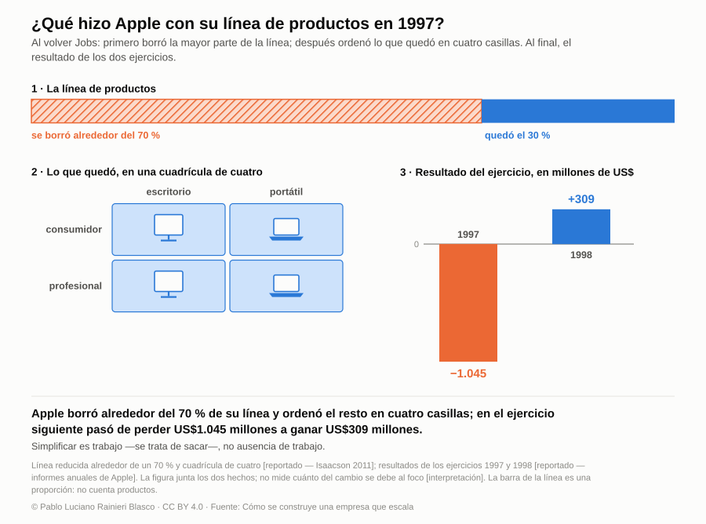

**Dónde falló.** La Lisa (1983): un producto excelente a un precio que el mercado no pagaba. Y NeXT, la empresa que Jobs fundó en 1985: como negocio de computadoras no funcionó. **Pero pasa la prueba del peldaño** (§3.6): su sistema operativo fue el activo que Apple compró a fines de 1996 y la base de los sistemas de sus computadoras y, después, de sus teléfonos `[reportado]`. El negocio fracasó; el activo quedó.

**Qué se copia a escala pequeña:** reducir la lista de productos o servicios a lo que se puede hacer excelente; cuidar la presentación con el mismo rigor que la fabricación; entender que simplificar es trabajo —se trata de sacar—, no ausencia de trabajo. **Qué no:** el carácter, que es rasgo, no mecanismo.

### 2.4 Amazon — el cliente, el volante y la caja

**El problema.** Vender por internet desde 1995, perdiendo dinero durante años. Cómo crecer sin morir en el intento.

**El mecanismo.**

- **Trabajar hacia atrás desde el cliente:** antes de construir algo, se escribe el comunicado de prensa y las preguntas frecuentes del día del lanzamiento. Si el comunicado no entusiasma, no se construye `[reportado — Bryar y Carr 2021]`.
- **El volante:** precios más bajos → más visitas → más vendedores → más variedad → mejor experiencia → más volumen → el costo fijo se reparte entre más unidades → precios más bajos `[reportado — Collins 2019]`.
- **La caja:** el cliente paga al comprar y el proveedor cobra semanas después. Una parte del crecimiento lo financia el propio negocio `[reportado]`.
- **El activo interno se vuelve producto:** en 2006 Amazon empezó a vender a terceros la infraestructura informática que había construido para sí misma (Amazon Web Services).
- **Dos tipos de decisión:** las reversibles se toman rápido y abajo; las irreversibles, despacio y arriba (carta a los accionistas de 2015).

**El número.** En febrero de 2000 Amazon colocó bonos convertibles por 690 millones de euros, unos US$680 millones de entonces `[informe anual de Amazon, 2000]`, semanas antes de que estallara la burbuja de internet. Entre fines de 1999 y 2001 la acción cayó más del 90 %. La primera ganancia anual completa llegó en 2003: US$35 millones `[reportado]`. **Ese dinero fue el colchón que permitió sobrevivir**: es el nivel 5 (§3.5) en acción.

**Dónde falló, y el grupo de control.** Webvan, de reparto de supermercado a domicilio, levantó cientos de millones, construyó depósitos antes de tener la demanda y quebró en 2001; Pets.com cerró en 2000 `[reportado]`. Misma época, misma tesis de «comercio por internet», sin colchón o con margen por unidad negativo. Y Amazon también falla: su teléfono (2014) le costó un cargo contable de US$170 millones `[reportado — informe trimestral de Amazon]`.

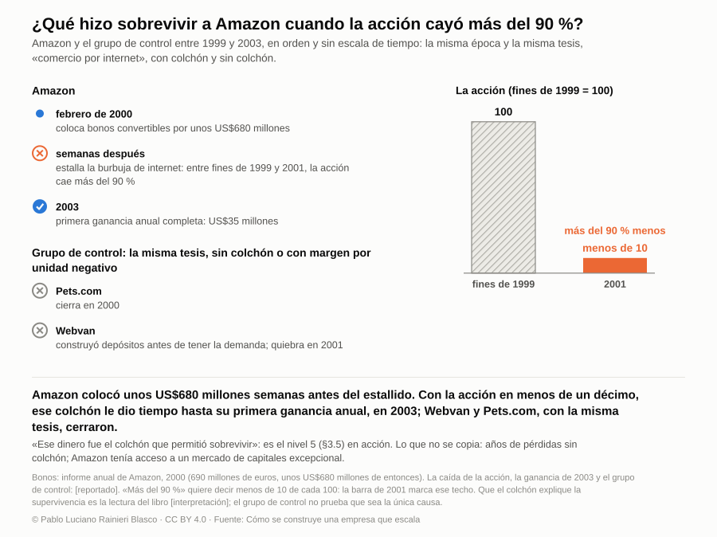

**Qué se copia a escala pequeña:** cobrar antes de pagar (anticipos, depósitos, suscripciones); escribir el anuncio antes de fabricar; separar las decisiones reversibles de las irreversibles. **Qué no:** años de pérdidas sin colchón: Amazon tenía acceso a un mercado de capitales excepcional.

### 2.5 SpaceX y Tesla — la restricción terminal y la reutilización

**El problema.** Poner carga en órbita costaba decenas de miles de dólares por kilo. El auto eléctrico era caro por el costo de las baterías.

**El mecanismo.** Diseñar hacia atrás desde un número (el costo por kilo); **reutilizar** para cambiar el denominador (§3.1); iterar con prototipos baratos; y **fabricar el propio cliente**: la constelación Starlink consume lanzamientos que ningún cliente externo pediría `[interpretación]`. Musk ordena su método en cinco pasos: cuestionar el requisito, borrar, simplificar, acelerar y automatizar, en ese orden (receta R4).

La cadena hacia atrás, eslabón por eslabón:

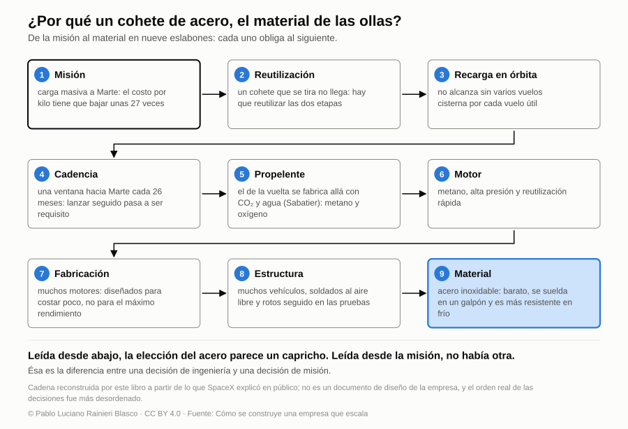

1. **Misión:** carga masiva a Marte. A los precios de hoy es imposible: el costo por kilo tiene que bajar más de un orden de magnitud, de unos US$2.700 a US$100, unas 27 veces. Los US$100 son un objetivo, no un dato (figura 10).
2. **Reutilización:** un cohete que se tira no baja 27 veces su costo. Hace falta reutilizarlo entero, las dos etapas.
3. **Recarga en órbita:** con reutilización total, la carga que llega a Marte no alcanza sin recargar combustible en órbita. Hacen falta varios vuelos cisterna por cada vuelo útil.
4. **Cadencia:** varios vuelos por misión, con una ventana hacia Marte cada 26 meses. Lanzar seguido deja de ser un lujo y pasa a ser un requisito.
5. **Propelente:** hay que volver, y el combustible de vuelta no se puede llevar. Tiene que fabricarse allá con lo que hay: dióxido de carbono de la atmósfera y agua. La química que lo permite (la reacción de Sabatier) da **metano** y oxígeno. Ahí quedan descartados el queroseno y el hidrógeno, no por gusto.
6. **Motor:** metano, alta presión y reutilización rápida.
7. **Fabricación:** cadencia alta significa muchos motores. El motor se diseña para costar poco al fabricarlo y al mantenerlo, no para el máximo rendimiento.
8. **Estructura:** muchos vehículos, soldados al aire libre y rotos seguido en las pruebas. El material se elige por costo y por facilidad de soldar, no por resistencia sobre peso.
9. **Material:** **acero inoxidable**. Es barato, se suelda en un galpón y, a las temperaturas muy bajas del combustible líquido, su resistencia sube en vez de bajar.

Leída al revés, la elección del acero parece arbitraria («¿acero, en pleno siglo XXI?»). Leída desde arriba, no había otra. Ésa es la diferencia entre una decisión de ingeniería y una decisión de misión.

**El número.** Costo por kilo a órbita baja: transbordador espacial ≈ US$54.500; Falcon 9 ≈ US$2.720 `[Jones 2018, NASA]`. El primer aterrizaje de una primera etapa fue en diciembre de 2015. El objetivo declarado para el Starship es del orden de US$100 por kilo `[objetivo declarado]`: dividir otra vez por 27, casi un orden de magnitud y medio, que no sale de optimizar el cohete anterior.

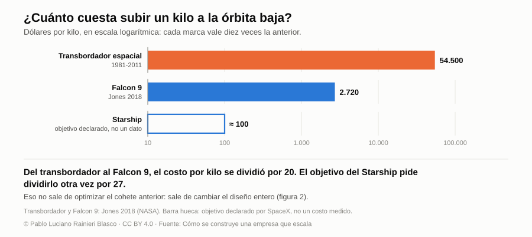

**Quién gana si el costo sube.** En 2010 la NASA estimó, con su modelo de costos NAFCOM, cuánto habría costado desarrollar el mismo Falcon 9 según cómo se contrata. Todos los valores son de la NASA, en millones de dólares de 2010, salvo el último:

| Cómo se contrata | Costo de desarrollo |
|---|---|
| Cultura NASA tradicional, costo más honorario | US$3.977 M |
| Enfoque más comercial, también a costo más honorario | US$1.695 M |
| Datos técnicos corregidos, a costo más honorario | US$1.383 M |
| Los mismos datos corregidos, a precio fijo (sin honorario, soporte del programa ni imprevistos) | US$443 M |
| Declarado por SpaceX: sólo el Falcon 9 | ≈ US$300 M |

`[verificado, primaria — NASA 2011, diapositivas 2, 5, 8 y 9; el último valor: NASA 2010, citado por Zapata 2017, que agrega ≈ 90 del Falcon 1 (≈ 390 en total) y la frase «la NASA verificó estos costos»]`

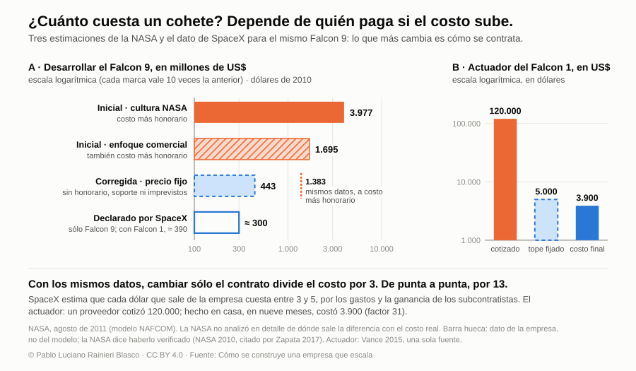

Las dos filas del medio son la comparación limpia, y la respuesta al tercer acertijo: **con los mismos datos, el contrato solo divide el costo por tres.** Con costo más honorario, cada dólar gastado de más lleva su honorario; con precio fijo, cada dólar ahorrado es del fabricante. SpaceX lo resume así: cada dólar que sale de la empresa cuesta en realidad entre 3 y 5 dólares, por los gastos generales y la ganancia de los subcontratistas `[verificado, primaria — estimación de SpaceX transcripta en NASA 2011, diapositiva 3]`.

**La salvedad, de la propia NASA:** no hizo un análisis detallado de por qué sus estimaciones y el costo real de SpaceX difieren tanto. El dato de SpaceX lo declaró la empresa, y la fuente no dice cómo lo verificó la NASA. Tampoco es un presupuesto: según la NASA, sus estimaciones no incluyen todos los costos de un proyecto real.

**Dónde estuvo a punto de fallar.** Los tres primeros vuelos del Falcon 1 fallaron (2006, 2007 y agosto de 2008). El cuarto, el 28 de septiembre de 2008, era el último para el que alcanzaba el dinero, y funcionó. En diciembre de ese año llegaron el contrato de la NASA para abastecer la Estación Espacial (día 23: doce vuelos, unos US$1.600 millones) y el cierre de una ronda de Tesla de unos US$40 millones en deuda convertible (día 24) `[reportado]`. Las dos empresas estuvieron a un evento de todo o nada de no existir. **El grupo de control:** Kistler Aerospace, que buscaba un cohete reutilizable y había reunido unos US$900 millones, entró en quiebra en 2003; en autos, Fisker y Better Place quebraron en 2013 `[reportado]`. Y el costo del método usado hacia afuera: la conducción autónoma anunciada «para el año que viene» durante años `[reportado]` (§7.1).

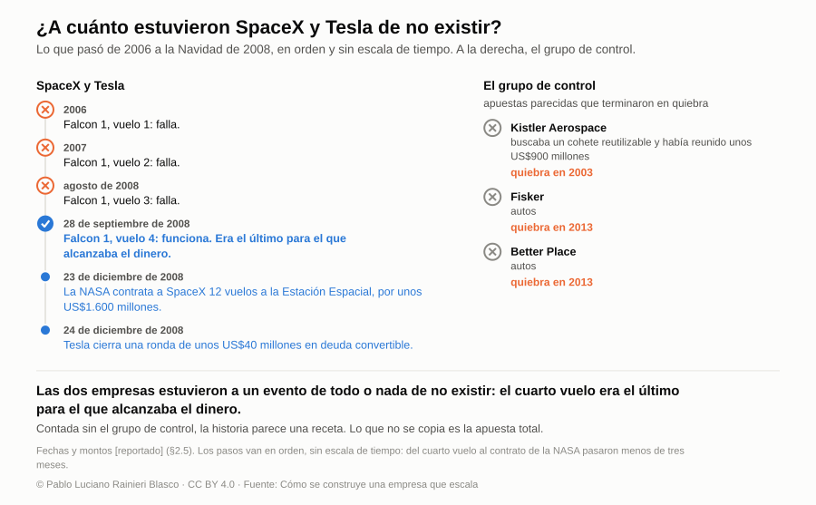

**Qué se copia a escala pequeña:** la cadena hacia atrás, abaratar el ciclo de prueba, borrar antes de automatizar. **Qué no:** la apuesta total ni los plazos imposibles prometidos en público.

### 2.6 La comparación

| Empresa | Lo que mejor enseña | Lo que la hizo fallar o casi fallar | Lo que no se copia |
|---|---|---|---|
| Ford | Flujo, estandarización, precio objetivo | La rigidez de la curva: un modelo para siempre | La apuesta a un único diseño |
| Toyota | Calidad en el proceso, derecho a parar | Crecer más rápido que su sistema de calidad | El vocabulario sin la práctica |
| Apple | Foco, producto integrado, presentación | Producto sin precio de mercado (Lisa) | El carácter del fundador |
| Amazon | Cliente primero, volante, caja | Productos sin demanda (teléfono) | Años de pérdidas sin colchón |
| SpaceX / Tesla | Restricción terminal, reutilización, iteración | Quedarse sin caja (2008) | La apuesta total y las promesas públicas |

**Lo que tienen en común las cinco:** una unidad que se repite, un costo por unidad que bajó con el volumen, al menos una etapa que dejó instalado un activo para la siguiente, y **al menos un momento de casi muerte o de error grave**. Lo último no es un detalle: es la parte de la historia que se omite cuando se la cuenta como receta de éxito.

---

## PARTE 3 — LAS CINCO CUENTAS

<div class="acertijo">

**El acertijo.** Un avión de pasillo único cuesta unos 50 millones de dólares y lleva unos 180 pasajeros. Si se tirara después de cada vuelo, ¿cuánto costaría sólo el avión por cada pasaje? ¿Y si se reutiliza toda su vida? Hacer la cuenta antes de leer §3.1.

</div>

El mismo objeto —*¿esto puede crecer?*— visto cinco veces, con más herramientas cada vez. Es la parte central del libro, y la que más se agradece haber leído con lápiz.

### 3.1 Nivel 1 — Repetir

> **La pregunta:** ¿la cosa se repite, o cada vez se empieza de cero?

**El objeto visual: un avión.** Un avión de pasillo único cuesta del orden de US$50 millones y lleva unos 180 asientos. Si se tirara después de cada vuelo, sólo el avión costaría **≈ US$280.000 por pasajero**. Como vuela del orden de 50.000 veces en su vida, ese mismo costo repartido es **≈ US$6 por pasajero** `[cálculo, orden de magnitud]`.

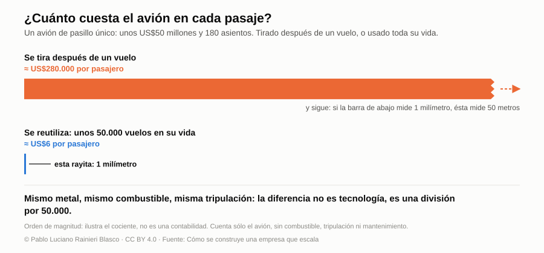

Mismo metal, mismo combustible, misma tripulación. **La diferencia no es tecnología: es una división por 50.000.**

Eso es exactamente el argumento de reutilizar cohetes, y también el de la plantilla, el molde y el procedimiento escrito. **En cualquier negocio:** el presupuesto que se rehace a mano, el diseño que no quedó parametrizado, el trámite que se aprendió y no se anotó, la conversación de venta improvisada cada vez. Cada uno es un avión que se tira después de un vuelo.

**El error típico:** confundir *repetir* con *repetirse*. Hacer el mismo trabajo a mano cuarenta veces no es reutilización: es desperdicio que parece experiencia.

### 3.2 Nivel 2 — La unidad económica

> **La pregunta:** cada vez que pasa una unidad, ¿entra más de lo que sale?

Con `p` = precio de la unidad, `cv` = costo variable de esa unidad (materiales, horas, comisiones, envío) y `CF` = costo fijo del período:

```
    margen de contribución:   m = p − cv
    punto de equilibrio:      Q* = CF / m       (unidades por período)
```

| Situación | Lectura | Qué hacer |
|---|---|---|
| `m < 0` | Cada unidad empobrece | **Prohibido escalar.** El volumen acelera la muerte |
| `m > 0`, `Q*` inalcanzable | El problema es el costo fijo o el precio, no las ventas | Achicar estructura, subir precio o bajar horas por unidad |
| `m > 0`, `Q*` alcanzable | Hay un negocio | Recién ahora tiene sentido el nivel 3 |

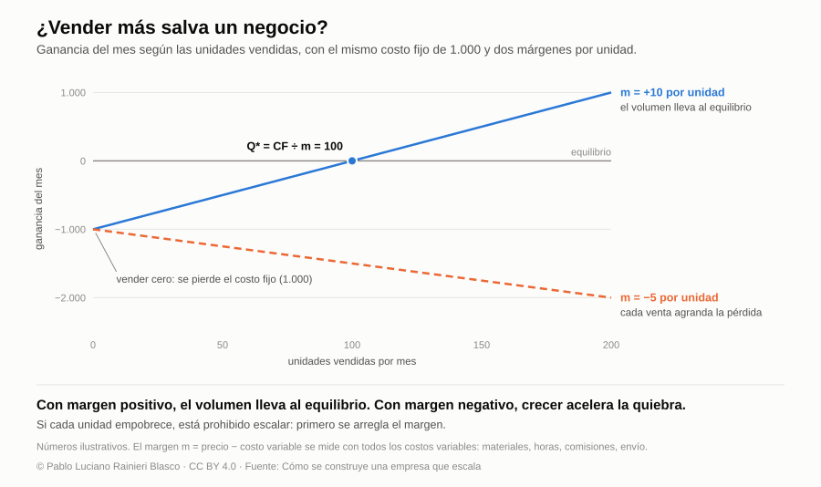

**Tres controles que casi nadie hace:**

- **La hora propia va siempre al costo variable, aunque no se cobre.** Un negocio que sólo cierra porque el dueño no se paga tiene un subsidio, no un margen, y el subsidio se termina el día que el dueño se enferma.
- **Medir por unidad, no por mes.** «En general va bien» es la frase que tapa que el 30 % de los trabajos tiene margen negativo y el 70 % restante lo financia.
- **Y verificar la capacidad:** si `Q*` exige más horas de las que tiene el mes, es inalcanzable aunque haya demanda.

**El caso, con su parte incómoda.** Durante años el resultado neto de Tesla dependió en buena medida de la venta de créditos regulatorios, un ingreso que no venía del producto `[reportado]`. **Si un renglón externo sostiene la cuenta —un subsidio, un cliente único, un tipo de cambio, el trabajo no pago del dueño— eso no es un margen: es una dependencia.**

### 3.3 Nivel 3 — La curva de aprendizaje y la economía de escala

> **La pregunta:** ¿cuánto baja el costo cada vez que se duplica la producción?

Acá empieza lo que casi nadie enseña. Hay **dos mecanismos distintos que se confunden**:

- **Economía de escala:** el costo fijo se reparte entre más unidades **por período**. Depende del volumen **de hoy**: si las ventas bajan, se pierde.
- **Curva de aprendizaje (ley de Wright, 1936):** el proceso mejora con la producción **acumulada** desde el primer día. Depende de **todo lo hecho**, pero no es permanente: el conocimiento de una organización se desgasta si no se usa y se va con la gente que se va (Argote y Epple 1990).

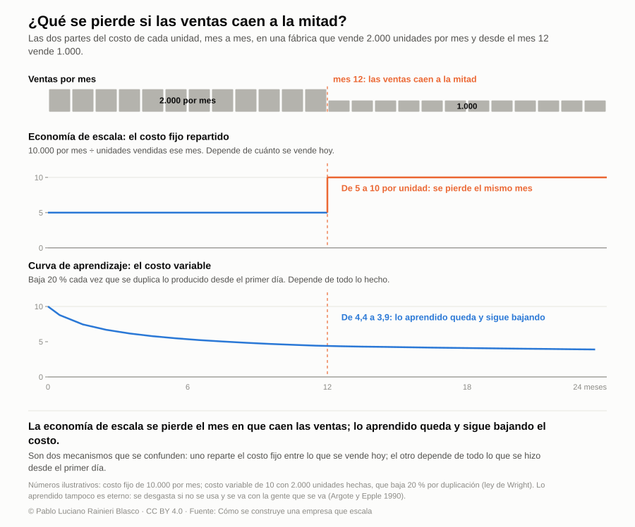

Con `r` = tasa de aprendizaje (cuánto baja el costo por duplicación del volumen acumulado):

```
    C(n) = C₁ · n^(−b)          con   b = −log₂(1 − r)

    duplicaciones necesarias para llegar a una fracción f del costo inicial:
    N = ln(f) / ln(1 − r)       y el volumen acumulado se multiplica por 2^N
```

**La tabla que decide todo.** Para bajar el costo a **la décima parte** `[cálculo]`:

| Tasa `r` por duplicación | Duplicaciones necesarias | Volumen acumulado × |
|---|---|---|
| 10 % | 21,8 | **≈ 3.800.000 ×** |
| 15 % | 14,2 | ≈ 18.400 × |
| 20 % | 10,3 | ≈ 1.280 × |
| 25 % | 8,0 | ≈ 256 × |
| 30 % | 6,5 | **≈ 88 ×** |

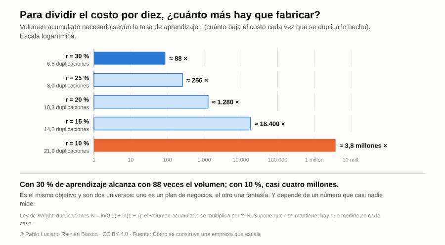

Ésa es la respuesta al primer acertijo, y por eso casi nadie la acierta: **depende de un número que casi nadie mide.** **Con 30 % de aprendizaje, bajar el costo diez veces exige multiplicar el volumen por 88. Con 10 %, por casi cuatro millones.** Es el mismo objetivo y son dos universos: uno es un plan de negocios, el otro una fantasía. Buena parte de lo que se atribuye a la intuición de los grandes empresarios podría venir de acá `[interpretación]`: entran donde el producto es fabricable y repetible —autos, baterías, paneles, motores— porque ahí `r` suele ser alto.

**El caso grande.** El precio de los paquetes de baterías de ion-litio pasó de más de US$1.100/kWh en 2010 a US$108/kWh en 2025 `[reportado — BloombergNEF]`: más de diez veces menos en quince años, mientras la producción acumulada crecía enormemente, como predice la ley de Wright. Pero hay que decirlo con cuidado: cuando la producción crece a ritmo exponencial, una simple tendencia contra el tiempo predice casi igual de bien, y los datos no permiten separar del todo las dos explicaciones (Nagy et al. 2013).

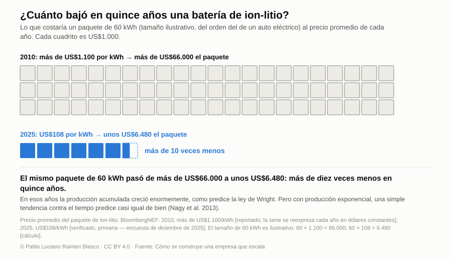

**Por qué la curva engaña a simple vista.** Dibujada contra el volumen en un eje común, la curva de Wright parece aplanarse enseguida, y da la impresión de que «ya no baja más». Dibujada con un eje en que cada marca es el doble de la anterior, es una escalera que sigue bajando el mismo 20 % en cada escalón: 100, 80, 64, 51, 41… La primera lectura hace abandonar a tiempo de perder; la segunda dice cuántos escalones faltan.

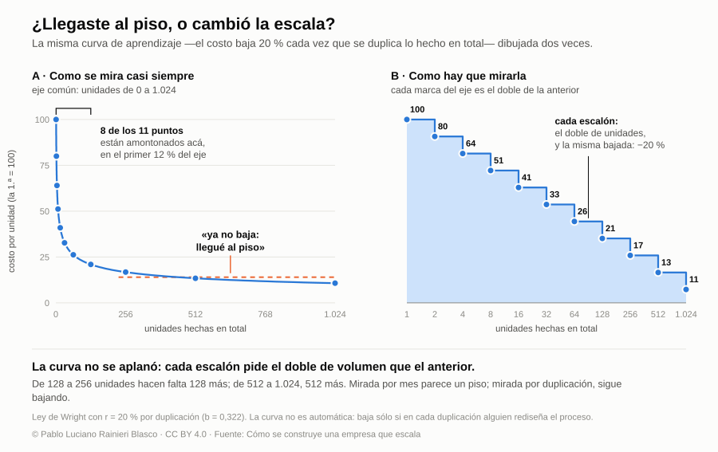

**Las dos trampas:**

- **La curva es un resultado, no un derecho.** Dutton y Thomas (1984), sobre más de doscientos estudios, distinguen el progreso que llega con la práctica del que hay que provocar con inversión: el molde, la plantilla, el proveedor nuevo, la máquina. Duplicar la producción haciendo exactamente lo mismo no garantiza que baje el costo.
- **La curva se paga con rigidez.** Cada duplicación especializa el proceso en un producto. Ford bajó el costo del Modelo T como nadie, y cambiarlo le costó medio año de fábrica parada (§2.1; Abernathy y Wayne 1974).

**El error más caro de este nivel:** cotizarle al cliente el costo del volumen futuro con el proceso del volumen actual. Así quiebran las empresas que venden mucho.

### 3.4 Nivel 4 — El lazo

> **La pregunta:** ¿el sistema se sostiene solo, o hay que empujarlo para siempre?

**El objeto visual: un volante de inercia.** Cuesta mucho el primer cuarto de vuelta, y después gira.

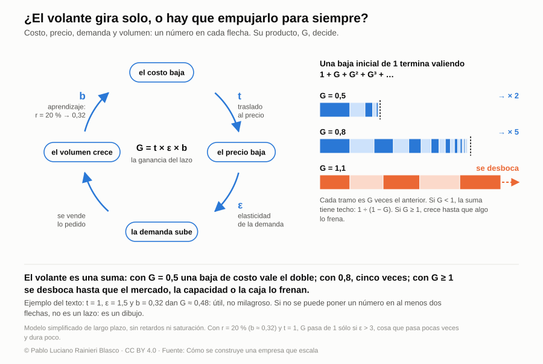

Cada flecha es un número que se puede estimar:

- `t` — **traslado:** qué fracción de la baja de costo se pasa al precio (1 = toda).
- `ε` — **elasticidad-precio de la demanda:** cuánto por ciento sube la demanda si el precio baja 1 %.
- `b` — **respuesta del costo al volumen:** por aprendizaje (nivel 3) o por reparto del costo fijo. Con `r` = 20 %, `b` ≈ 0,32.

**La ganancia del lazo es el producto de las flechas:** `G ≈ t × ε × b` `[cálculo; modelo simplificado de largo plazo, sin retardos ni saturación]`. Los lazos con retardo y saturación son el objeto de la dinámica de sistemas (Sterman 2000); éste es su modelo mínimo.

- **Si `G` es menor que 1, el lazo amplifica pero se estabiliza.** Una baja inicial del costo termina valiendo `1 / (1 − G)` veces lo que valía sola. *Ejemplo:* con `t` = 1, `ε` = 1,5 y `b` = 0,32, `G` ≈ 0,48, y una baja inicial del 10 % termina acercándose al doble. Útil, no milagroso. Es el caso normal.
- **Si `G` es mayor que 1, el lazo se desboca** hasta que algo lo frena: el mercado se satura, falta capacidad o falta caja. Con `r` = 20 % hace falta `ε` mayor que 3 —que la demanda suba más del 30 % por cada 10 % de baja de precio—, algo que pasa pocas veces y dura poco.
- **No confundirlo con otra condición:** si `ε` es menor que 1, bajar el precio **reduce** el ingreso total. Eso dice si conviene bajar el precio; no dice si el lazo gira.

**El volante de Amazon tiene más flechas** —más clientes atraen más vendedores, y más vendedores más variedad— y por eso puede tener más ganancia que un lazo sólo de costo y precio. Pero la regla es la misma:

> **Si no se puede poner un número en al menos dos flechas, no es un lazo: es un dibujo.** El diagrama circular en una presentación es el disfraz más común de un modelo de negocio que no existe.

**El retardo.** Entre que baja el costo y que la demanda responde pasan meses. Un lazo con retardo de nueve meses y caja para seis no es un lazo: es una trampa. Por eso existe el nivel 5.

**Fabricar el cliente.** Cuando el mercado no alcanza para mover el volante, se puede ser el propio cliente: Starlink compra lanzamientos a SpaceX. Y al revés: cuando sobra capacidad interna, se la puede vender: Amazon Web Services. Son dos caras del mismo principio.

### 3.5 Nivel 5 — El capital, el tiempo y la ruina

> **La pregunta:** ¿alcanza el dinero para llegar hasta el punto donde el negocio se sostiene solo?

Es el nivel que nadie quiere leer y el que decide quién sigue vivo en el año tres.

**El objeto visual: la curva J.** Un pozo con **profundidad** y **ancho** medibles.

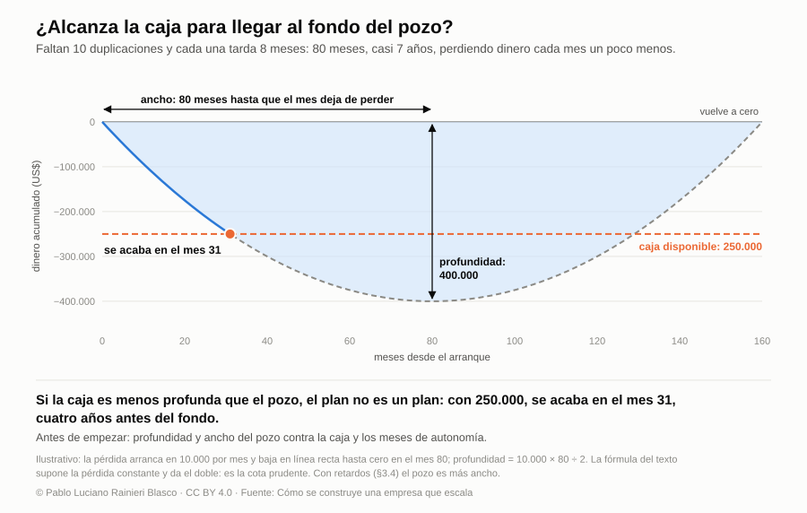

```
    profundidad ≈ (CF − m·Q_actual) × meses_hasta_equilibrio  +  inversión en el proceso
    autonomía   = caja disponible / pérdida mensual             (en meses)
    veredicto:  si la autonomía es menor que el ancho del pozo, el plan NO es un plan
```

**La cuenta que casi nadie hace:** cruzar el nivel 3 con éste. Si faltan 10 duplicaciones y cada una tarda 8 meses, el plan dura más de seis años, y hay que financiar seis años.

**El riesgo de ruina, bien dicho.** Apostar todo maximiza el valor **esperado** de una jugada. Pero cuando la jugada se repite, lo que importa es la tasa de crecimiento, y esa depende del promedio geométrico, no del aritmético: una pérdida del 50 % necesita una ganancia del 100 % para volver al punto de partida. En fórmula: `g ≈ μ − σ²/2` —la volatilidad resta crecimiento—. El criterio de Kelly (1956) da la fracción que maximiza el crecimiento a largo plazo, y es **siempre menor que el total** cuando la apuesta puede salir mal. *Ejemplo:* con una moneda que gana el 60 % de las veces y paga lo apostado, Kelly indica apostar el 20 % del capital; quien apuesta todo en cada tirada tiene, después de diez tiradas, un 0,6 % de probabilidad de seguir en juego `[cálculo]`. **Una ruina saca del juego para siempre, y las ganancias futuras se multiplican por cero.**

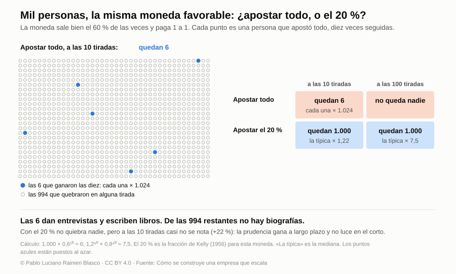

Con mil personas se ve mejor `[cálculo]`. Si las mil apuestan todo en cada tirada, a las diez tiradas quedan unas **seis**, y cada una multiplicó su dinero por 1.024; a las cien tiradas no queda nadie. Si las mil apuestan el 20 %, no quiebra nadie, y a las cien tiradas la persona típica (la mediana) multiplicó su dinero por unas 7,5 veces. A las diez tiradas, en cambio, la regla prudente casi no se nota: la mediana apenas sube un 22 %. **La prudencia no luce en el corto plazo, y por eso casi nadie la elige.**

**Las dos formas buenas de financiar el pozo:**

- **Con el cliente:** cobrar antes de pagar. Amazon cobra al vender y paga semanas después; un taller puede pedir anticipo; un servicio puede cobrar por suscripción. A diferencia de un préstamo, no paga interés explícito. El crédito de los proveedores, en cambio, puede salir caro: renunciar a un descuento por pronto pago equivale a veces a una tasa muy alta (Petersen y Rajan 1997).
- **Con un colchón conseguido antes de necesitarlo:** Amazon colocó sus bonos semanas antes de la caída de 2000. El dinero se consigue cuando no hace falta; cuando hace falta, ya no está.

**La regla dura:**

> **Nunca se financia la etapa siguiente con el dinero que hace falta para sobrevivir a la actual.**

Y su corolario: separar el patrimonio del proyecto **antes** de que el proyecto crezca. Una apuesta acotada que se puede repetir cinco veces vale más que una apuesta total que se puede hacer una sola vez.

**El error típico: confundir un negocio que necesita capital con uno que necesita clientes.** Son enfermedades opuestas. *Prueba rápida:* si mañana aparecieran diez clientes, ¿se los podría atender? Si la respuesta es no, falta capacidad, y eso se compra con capital. Si es sí, falta demanda, y meterle capital sólo estira la agonía.

### 3.6 La prueba del peldaño

Ante cualquier etapa que se está por empezar, una sola pregunta:

> **¿Qué queda instalado cuando esta etapa termine, que haga más barata la siguiente?**

Si la respuesta es «más clientes», «más dinero» o «más experiencia», **no es un peldaño: es un piso**. Se puede vivir muy bien en un piso, pero desde un piso no se sube. Un peldaño instala un **activo**: *algo que se usa muchas veces sin volver a pagarlo entero.*

| Lo que la etapa produjo | ¿Activo? | Por qué |
|---|---|---|
| US$40.000 facturados | No | Se gasta una vez |
| 12 clientes nuevos | No | Se van; hay que reconseguirlos |
| «Aprendimos mucho» | No | Si no está escrito, se va con quien se va |
| El presupuesto tipo, parametrizado | **Sí** | La cotización número 40 cuesta 10 minutos, no 3 horas |
| El molde, la matriz, la plantilla | **Sí** | Se amortiza contra volumen |
| La habilitación, el permiso | **Sí** | Es una barrera para el que viene atrás |
| El proceso ejecutado por alguien que no es el dueño | **Sí** | Es lo único que saca al dueño del cuello de botella |
| El sistema operativo de NeXT, la infraestructura de Amazon | **Sí** | El negocio que lo produjo pudo fracasar; el activo quedó |

**El ingreso financia; el activo capitaliza.** Muchos negocios que «crecen» durante años sólo producen ingreso, y por eso el año cinco cuesta lo mismo que el año uno. Eso no es una escalera: es una cinta de correr.

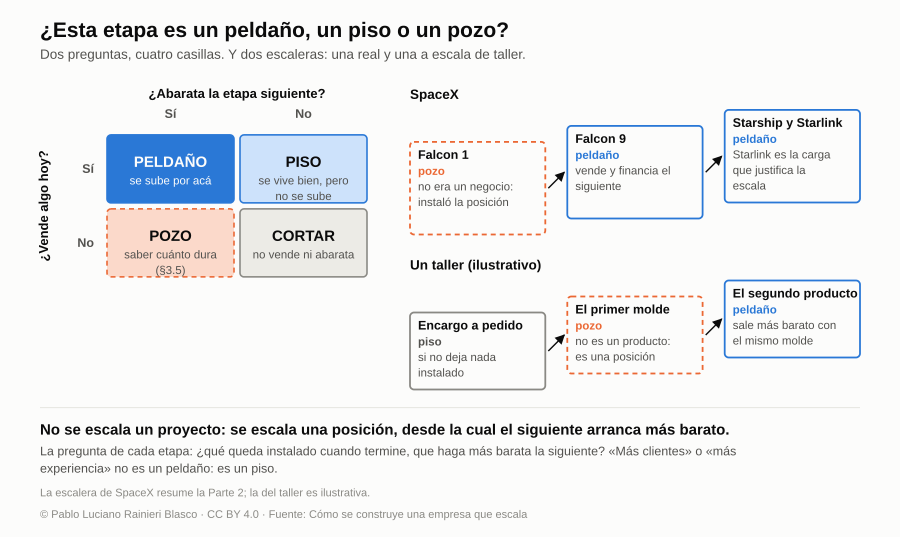

Dos preguntas alcanzan para clasificar cualquier etapa: *¿vende algo hoy?* y *¿abarata la siguiente?* Si hace las dos cosas, es un **peldaño**. Si sólo vende, es un **piso**. Si sólo abarata, es un **pozo**, y hay que saber cuánto dura (§3.5). Si no hace ninguna, hay que cortarla.

### 3.7 La síntesis de los cinco niveles

| Nivel | La pregunta | Lo que da |
|---|---|---|
| 1 | ¿Se repite? | La **unidad** |
| 2 | ¿Deja dinero cada vez? | El **permiso** de escalar |
| 3 | ¿Cuánto baja al duplicar? | La **distancia**, contada en duplicaciones |
| 4 | ¿Se sostiene solo? | La **viabilidad** del lazo |
| 5 | ¿Alcanza la caja hasta ahí? | La **supervivencia** |

**Quien se saltea el nivel 2 quiebra vendiendo. Quien se saltea el nivel 3 promete precios que no puede cumplir. Quien se saltea el nivel 5 tiene razón en todo y cierra igual.**

---

## PARTE 4 — EL RECETARIO

<div class="acertijo">

**El acertijo.** Un proveedor cotiza una pieza para un cohete en 120.000 dólares. Un ingeniero que nunca fabricó una pieza recibe la orden de hacerla por 5.000. ¿Lo logra? ¿Cuánto termina costando? Está en la receta R9.

</div>

Doce recetas, una por necesidad. Cada una dice para qué sirve, qué hace falta, los pasos, cómo saber si salió bien, el error típico y de dónde viene. Son procedimientos de práctica profesional: su eficacia no se midió en estudios controlados, salvo donde se cita una fuente `[hipótesis]`. El criterio de «salió bien» está para que cada uno la mida en su propio negocio.

### R1 — Escribir el anuncio antes de fabricar

**Para qué:** comprobar que el producto resuelve un problema real antes de gastar en construirlo. **Función:** entender al cliente.

**Ingredientes:** una hoja; tres clientes posibles con nombre.

**Pasos:**

1. Redactar el anuncio del día del lanzamiento: qué problema resuelve, para quién, y por qué es mejor que lo que el cliente usa hoy. Máximo una carilla.
2. Redactar las cinco preguntas más difíciles que haría un cliente escéptico, con sus respuestas.
3. Mostrárselo a los tres clientes posibles y pedir un compromiso concreto: un anticipo, una firma, una reunión con quien decide.

**Salió bien si:** al menos uno de los tres ofrece algo que le cuesta (dinero, tiempo, una firma). El entusiasmo verbal no cuenta.

**Error típico:** escribir el anuncio desde el producto («tiene tal función») en vez de desde el problema del cliente.

**De dónde viene:** Amazon, que lo usa como paso obligatorio antes de construir.

### R2 — La cadena hacia atrás desde el número final

**Para qué:** convertir una misión en una decisión de esta semana. **Función:** definir el producto.

**Ingredientes:** la misión en una línea y el número que la haría posible (un valor y una unidad).

**Pasos:**

1. Escribir el número final: un precio, un costo por unidad, una cantidad por mes.
2. Preguntar: *para que eso sea cierto, ¿qué tiene que ser cierto antes?* Anotar la respuesta.
3. Repetir la pregunta sobre cada respuesta hasta llegar a algo que se pueda decidir o hacer esta semana.

**Salió bien si:** la cadena termina en una acción con fecha de esta semana. **Si no llega a esta semana, la misión todavía no es un proyecto.**

**Error típico:** detenerse en un eslabón abstracto («mejorar la eficiencia»).

**De dónde viene:** Ford (precio → un modelo → piezas iguales → flujo) y SpaceX (costo por kilo → reutilización → metano → acero).

### R3 — Recortar la lista de productos

**Para qué:** concentrar recursos donde se puede ser excelente. **Función:** definir el producto.

**Ingredientes:** la lista completa de productos o servicios, con el margen de cada uno (receta R7).

**Pasos:**

1. Ordenar la lista por margen total del último año.
2. Dibujar una cuadrícula de dos ejes que describan a los clientes (por ejemplo: particular o empresa; urgente o planificado) y dejar **un solo producto por casilla**.
3. Todo lo que no entra en la cuadrícula se discontinúa o se deriva a otro.

**Salió bien si:** la lista quedó al menos a la mitad y el margen total no cayó en el trimestre siguiente.

**Error típico:** conservar un producto «porque un cliente lo pide». Se evalúa por el margen, no por el pedido.

**De dónde viene:** Apple, 1997.

### R4 — El algoritmo de cinco pasos

**Para qué:** mejorar un proceso o un producto sin optimizar lo que no debería existir. **Función:** producir.

**Pasos, en este orden:**

1. **Cuestionar el requisito, y ponerle un nombre.** Todo requisito tiene que poder atribuirse a una persona, no a «la norma» o «el cliente». Si nadie sabe quién lo pidió, probablemente sea un requisito heredado.
2. **Borrar la parte o el paso.** Criterio de calibración: si no hace falta volver a agregar al menos el 10 % de lo que se borró, no se borró suficiente.
3. **Simplificar y optimizar**, recién ahora.
4. **Acelerar el ciclo.** Sólo lo que sobrevivió a los pasos anteriores.
5. **Automatizar, último.**

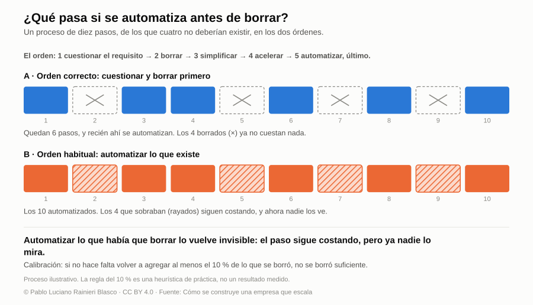

**El orden correcto:** cuestionar, borrar, simplificar, acelerar y, al final, automatizar. **El habitual:** automatizar lo que existe y después preguntarse por qué no mejoró nada.

**Salió bien si:** la lista de pasos del proceso es más corta que antes y hubo que reponer alguno.

**Error típico:** empezar por el paso 5 porque es el que se ve moderno.

**De dónde viene:** enunciado por Musk (Isaacson 2023); el orden coincide con el de Toyota, que automatiza sólo procesos ya estabilizados.

### R5 — Detener el trabajo y preguntar cinco veces por qué

**Para qué:** que cada defecto se corrija una sola vez. **Función:** producir.

**Pasos:**

1. Regla escrita: **cualquier persona puede detener el trabajo ante un defecto**, sin pedir permiso.
2. Ante cada defecto, preguntar «¿por qué ocurrió?» y, sobre la respuesta, otra vez «¿por qué?», hasta llegar a una causa sobre la que se pueda actuar (suelen ser cinco rondas).
3. Corregir la causa, no el síntoma, y anotar el caso en un registro de una línea: fecha, defecto, causa, corrección.

**Salió bien si:** el mismo defecto no vuelve a aparecer en el registro.

**Error típico:** terminar en «error humano». Una persona que se equivoca es un síntoma; la pregunta siguiente es por qué el proceso lo permitió.

**De dónde viene:** Toyota (Ohno; el cordón andon).

### R6 — Medir el flujo: tiempo total contra tiempo que agrega valor

**Para qué:** encontrar dónde se pierde el tiempo. **Función:** producir.

**Pasos:**

1. Seguir una unidad real desde el pedido hasta la entrega, y anotar cada paso con su duración.
2. Marcar qué pasos cambian algo que el cliente pagaría (agregan valor) y cuáles son espera, transporte, retrabajo o inventario.
3. Calcular el cociente: tiempo que agrega valor / tiempo total.

**Salió bien si:** se conoce el cociente y el paso más largo que no agrega valor. Ese es el primer objetivo de la receta R4.

**Error típico:** medir sólo el tiempo de fabricación y no el de espera. En la mayoría de los procesos la espera es la mayor parte.

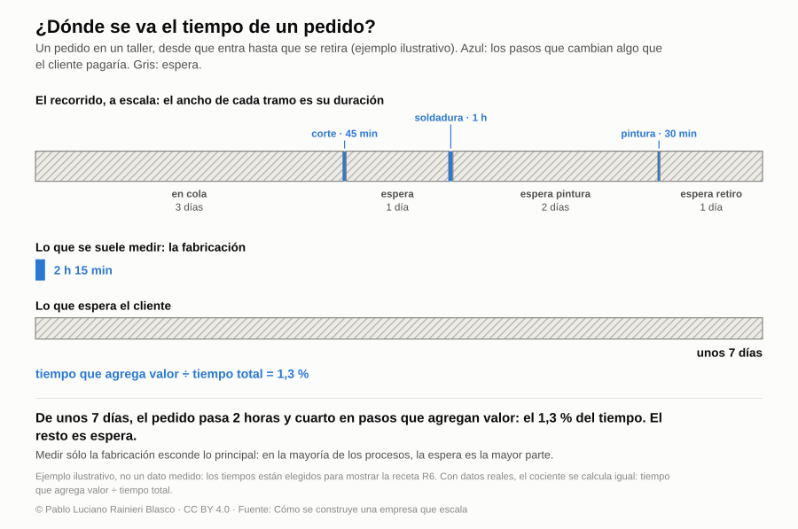

**De dónde viene:** Ford (la pieza viaja hacia la persona) y Toyota (los siete desperdicios).

### R7 — Calcular el margen por unidad con la hora propia

**Para qué:** saber si hay permiso para crecer (nivel 2). **Función:** financiar.

**Pasos:**

1. Elegir las últimas diez unidades vendidas.
2. Para cada una: precio cobrado, materiales, horas dedicadas **por todos, incluido el dueño**, multiplicadas por el valor de mercado de esa hora, y cualquier otro costo variable.
3. Calcular `m = p − cv` para cada una, no el promedio.

**Salió bien si:** se sabe cuántas de las diez tienen margen negativo y por qué.

**Error típico:** poner la hora del dueño en cero.

**De dónde viene:** contabilidad de costos básica; es el control G1 (§6.3).

### R8 — Medir la tasa de aprendizaje propia

**Para qué:** saber si el costo va a bajar con el volumen, y cuánto (nivel 3). **Función:** producir.

**Pasos:**

1. Registrar el costo (u horas) de cada unidad desde la primera, con el número de orden.
2. Comparar el costo de la unidad `n` con el de la unidad `2n` (la 1 con la 2, la 4 con la 8, la 16 con la 32).
3. `r = 1 − C(2n)/C(n)`. Con la tabla del §3.3, calcular cuántas duplicaciones faltan para el costo objetivo.

**Salió bien si:** hay al menos dos duplicaciones medidas y la tasa se parece entre ellas.

**Error típico:** estimar la tasa sin datos propios, o tomar la de otra industria.

**De dónde viene:** Wright, 1936.

### R9 — El índice idiota

**Para qué:** saber si se puede competir por proceso, y si conviene fabricar en vez de comprar. **Función:** definir el producto.

**Pasos:**

1. Tomar un producto o una pieza que ya existe en el mercado.
2. Calcular el costo de sus materias primas al precio de mercado.
3. Dividir el precio de venta por ese costo. Ese cociente es el índice.
4. Si el índice es alto, preguntar quién gana si el costo sube: con qué tipo de contrato se fabrica, cuántos intermediarios cobran su parte y qué certificación se está pagando (§2.5, «Quién gana si el costo sube», y la figura del mismo cohete).
5. Antes de reemplazar la pieza, pasarla por los cinco casos en que **no** conviene (abajo).

**El caso.** SpaceX necesitaba un actuador para orientar el motor de la etapa superior del Falcon 1. Un proveedor lo cotizó en US$120.000. Musk fijó un presupuesto de US$5.000: «no es más complicado que el motor de un portón de garaje». El ingeniero, Steve Davis, que nunca había construido una pieza, tardó nueve meses en diseñarlo. Costó US$3.900 y voló `[reportado — Vance 2015; una sola fuente, el testimonio de Davis]`. Hay un factor 31 entre la cotización y el costo final: es la respuesta al acertijo de esta parte.

**Salió bien si:** se interpreta el cociente. **Cerca de 1:** casi todo lo que se paga es material; no conviene competir por proceso. **Alto (10, 50 veces):** lo que se paga es proceso, poco volumen, certificación o intermediación, y ahí hay espacio.

**Cuándo NO conviene reemplazar la pieza.** El sobreprecio a veces paga algo real. No se reemplaza si:

| Caso | Qué pasa | Cómo se comprueba |
|---|---|---|
| 1. La falla es catastrófica | El modo de falla es irreversible y el ahorro no compensa el riesgo | probabilidad de falla × costo de la falla > ahorro |
| 2. El volumen es bajo | Se van a hacer tan pocas piezas que el herramental no se amortiza | el costo propio, calculado al volumen real, es igual o mayor que el precio de compra |
| 3. Recalificar es caro | Validar y certificar la pieza nueva cuesta más que la diferencia | horas de ingeniería y de ensayo medidas, no estimadas con optimismo |
| 4. El papel es parte del producto | En un rubro regulado, la pieza nueva rompe una certificación que exige la ley o el cliente | ¿el cambio invalida un certificado exigido? |
| 5. El ahorro es falso | La pieza barata aumenta las devoluciones y las garantías | costo total durante la vida útil, no precio de compra |

**El contraejemplo: el Challenger.** El 28 de enero de 1986 el transbordador despegó con 2 °C. El lanzamiento más frío hasta entonces había tenido los anillos de sellado de los propulsores a 12 °C. Los ingenieros del fabricante recomendaron no lanzar por debajo de esa temperatura, porque no tenían datos de que los anillos sellaran con más frío. La gerencia trató el límite como un requisito discutible y lanzó. Un anillo no selló, y el vehículo se desintegró a los 73 segundos con siete tripulantes `[verificado, primaria — Comisión Rogers 1986]`. Es el caso 1 de la tabla: el requisito que parece excesivo a veces es física.

**Error típico:** creer que el índice alto siempre es despilfarro. A veces paga algo real y difícil, como la certificación, la garantía o el servicio.

**De dónde viene:** Lawrence Miles, análisis de valor, General Electric, 1947. Musk lo popularizó como «índice idiota». El caso de la turbobomba del motor Merlin muestra que la intermediación también es tiempo: comprar a través de la NASA las turbobombas del motor Fastrac llevaba «uno o dos años», y SpaceX fue directo al fabricante, Barber-Nichols `[verificado, secundaria — Berger 2021; Mueller 2022]`. La turbobomba que entregaron en 2003 tuvo problemas graves, y el equipo de SpaceX terminó rediseñándola: ir directo ahorró tiempo, pero no resolvió el problema técnico.

### R10 — Volver visible la calidad

**Para qué:** que el cliente pague la calidad que no puede ver. **Función:** vender.

**Pasos:**

1. Listar lo que el producto hace bien y el cliente no puede comprobar al comprarlo (durabilidad, precisión, atención posterior).
2. Para cada punto, elegir una señal que lo haga visible: **una garantía** que cueste cara si el producto falla, una presentación cuidada, una demostración, un registro de trabajos anteriores.
3. Simplificar lo que el cliente ve: menos opciones, menos pasos, menos texto.

**Salió bien si:** la garantía ofrecida es más larga que la de la competencia y su costo real, medido, es bajo.

**Error típico:** ofrecer una garantía que la calidad real no sostiene. La garantía funciona como señal justamente porque cuesta cara si se miente.

**De dónde viene:** Apple («imputar», Markkula); Toyota (la confiabilidad como marca); Hyundai, que a fines de los noventa (1998-1999) lanzó en Estados Unidos una garantía de diez años o 100.000 millas para contrarrestar una fama de baja calidad `[reportado]`. La teoría es de Akerlof (1970) y Spence (1973): cuando el comprador no puede distinguir la calidad, una garantía o una señal costosa es una de las instituciones que lo resuelven.

### R11 — Cobrar antes de pagar

**Para qué:** financiar el crecimiento con el propio negocio (nivel 5). **Función:** financiar.

**Pasos:**

1. Medir el ciclo de caja: días que pasan desde que se paga al proveedor hasta que se cobra al cliente.
2. Acortarlo desde las dos puntas: anticipos, depósitos, cobro al contado o por suscripción; plazos con proveedores.
3. Recalcular la profundidad del pozo con el ciclo nuevo.

**Salió bien si:** el ciclo de caja se acortó y el pozo se achicó.

**Error típico:** crecer en ventas con ciclo largo. Cuanto más se vende, más dinero queda atrapado.

**De dónde viene:** Amazon.

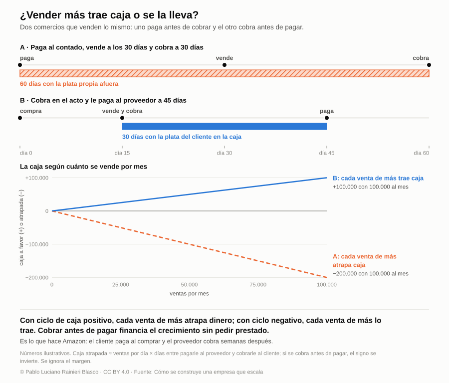

### R12 — Escribir el control antes de empezar la etapa

**Para qué:** evaluar en vez de justificar. **Función:** organizar.

**Pasos:**

1. Antes de gastar en la etapa, completar la plantilla del §6.2: condición numérica, fecha, evidencia y qué se hace si no se cumple.
2. Clasificar cada decisión de la etapa: **reversible** (se toma rápido y la toma quien está más cerca) o **irreversible** (se toma despacio, con datos y por escrito).
3. En la fecha, comparar contra lo escrito, no contra lo que se recuerda.

**Salió bien si:** en la fecha se ejecutó la acción elegida, incluso si era matar el proyecto.

**Error típico:** escribir el control al final. Quien lo escribe mirando los resultados fabrica el criterio que los aprueba.

**De dónde viene:** Amazon (decisiones de dos tipos) y la práctica de ingeniería de controles por etapa.

---

## PARTE 5 — CÓMO SE VE LA MAGNITUD

<div class="acertijo">

**El acertijo.** Un negocio factura mil dólares por año. ¿Cuántas veces tiene que duplicarse para facturar mil millones? ¿Cien? ¿Mil? Está en §5.1.

</div>

Los números grandes no se entienden: se comparan.

### 5.1 La regla de las duplicaciones

| Duplicaciones | Se multiplica por | | Duplicaciones | Se multiplica por |
|---|---|---|---|---|
| 1 | 2 | | 6 | 64 |
| 2 | 4 | | 10 | 1.024 |
| 3 | 8 | | 17 | 131.072 |
| 4 | 16 | | 20 | 1.048.576 |

> **Diez duplicaciones son mil veces. Veinte son un millón de veces.** De mil dólares a mil millones hay unas veinte duplicaciones, no mil.

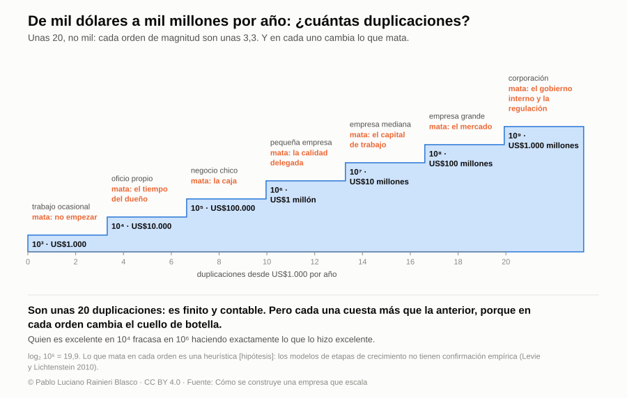

Es aritmética, no motivación: la distancia entre lo que se hace hoy y algo enorme se mide en duplicaciones, y son menos de las que parece. **La versión honesta:** cada duplicación es más difícil que la anterior, porque en cada una cambia el cuello de botella (§5.2). La regla no dice que sea fácil: dice que es finito y contable.

| Si se duplica cada… | 10 duplicaciones (× 1.000) tardan | 20 duplicaciones (× 1.000.000) tardan |
|---|---|---|
| 3 meses | 2 años y medio | 5 años |
| 6 meses | 5 años | 10 años |
| 12 meses | 10 años | 20 años |
| 24 meses | 20 años | 40 años |

Elegir el ritmo **es** la decisión estratégica, y la respuesta correcta casi nunca es «lo más rápido posible»: es el ritmo más rápido que la caja soporta.

### 5.2 La escalera de órdenes de magnitud — qué mata en cada peldaño

**Es una heurística, no un resultado** `[hipótesis]`. Se parece a los modelos de etapas de crecimiento (Greiner 1972; Churchill y Lewis 1983), y una revisión de 104 de esos modelos no encontró consenso sobre cuáles son las etapas ni confirmación empírica (Levie y Lichtenstein 2010). Sirve para hacerse la pregunta —¿qué cambia en el próximo orden de magnitud?—, no para predecir la respuesta.

| Orden | Facturación anual | Qué es | **Qué la mata en este peldaño** | Qué activo la saca de ahí |
|--|-----|-----|---------|---------|
| 10³ | US$1.000 | trabajo ocasional | nada; el único riesgo es no empezar | el primer trabajo cobrado |
| 10⁴ | US$10.000 | oficio propio | **el tiempo del dueño** | proceso escrito y presupuesto repetible |
| 10⁵ | US$100.000 | negocio chico | **la caja**: cobra tarde y paga temprano | anticipos, previsión de caja, elegir clientes |
| 10⁶ | US$1.000.000 | pequeña empresa | **la calidad delegada** y la primera contratación | alguien que ejecute el proceso sin el dueño |
| 10⁷ | US$10 millones | empresa mediana | **el capital de trabajo** y la falta de información | contabilidad real, financiamiento estructurado |
| 10⁸ | US$100 millones | empresa grande | **el mercado**: el producto ya no es un encargo | producto de plataforma, marca propia |
| 10⁹ | US$1.000 millones | corporación | **gobierno interno y regulación** | acceso al mercado de capitales |

**El problema del peldaño de arriba nunca es «más de lo mismo»:** es otro problema, y por eso quien es excelente en 10⁴ fracasa en 10⁶ haciendo exactamente lo que lo hizo excelente. Y son siete renglones: la distancia entre un trabajo ocasional y una corporación son seis órdenes de magnitud, y ya se sabe qué mata en cada uno.

### 5.3 El reloj de iteración

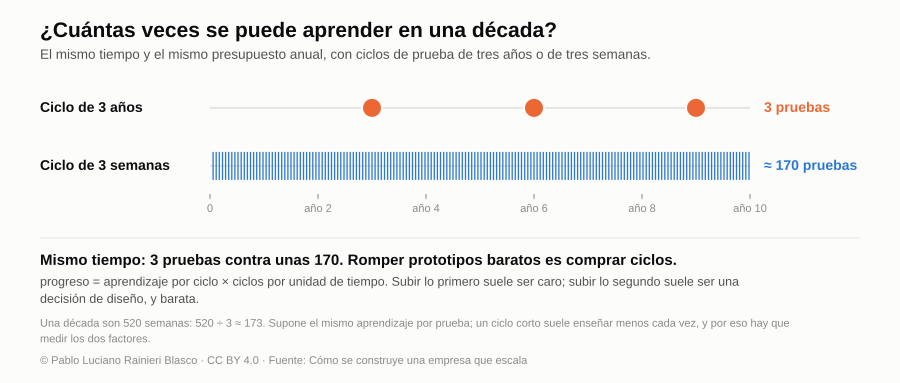

Mismo tiempo, mismo presupuesto anual, y unas cincuenta veces más intentos de los que aprender. **Romper prototipos baratos es comprar ciclos.**

```
   progreso  =  (aprendizaje por ciclo)  ×  (ciclos por unidad de tiempo)
```

Subir el aprendizaje por ciclo requiere gente mejor y suele ser caro. **Subir la cantidad de ciclos suele ser una decisión de diseño y suele ser barata:** prototipar en un material más barato, simular antes, probar a escala reducida, dividir el experimento. Cuando algo no funciona, la primera pregunta no es «¿cómo lo mejoro?» sino **«¿cómo hago para probarlo diez veces por el precio de una?»**.

### 5.4 La regla del segundo

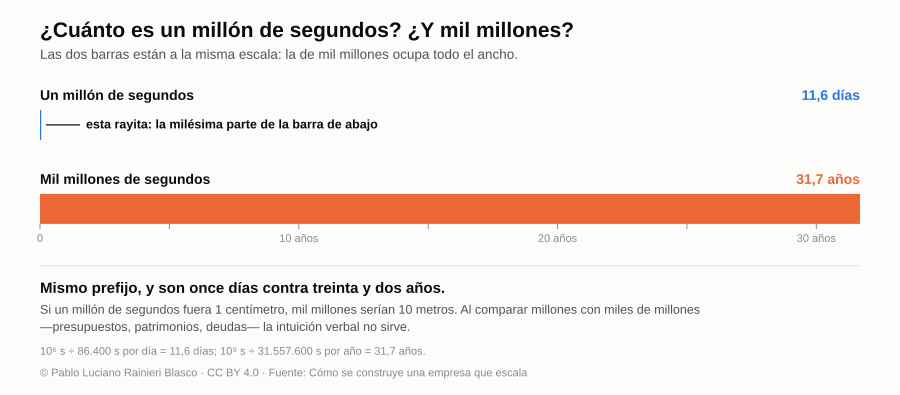

Es la respuesta al cuarto acertijo. Mismo prefijo, y son once días contra treinta y dos años. Al comparar millones con miles de millones —presupuestos, patrimonios, deudas— la intuición verbal no sirve; sirve la escala de órdenes de magnitud.

---

## PARTE 6 — LOS CONTROLES ANTES DE CADA ETAPA

<div class="acertijo">

**El acertijo.** ¿Cuándo conviene escribir la condición para abandonar un proyecto: antes de empezarlo, o cuando empieza a ir mal y ya hay datos? Elegir una y dar el porqué; está en §6.1 y en la receta R12.

</div>

### 6.1 Qué es un control y por qué se escribe antes

Un **control de etapa** es una condición numérica, verificable y con fecha que tiene que cumplirse **antes** de gastar en la etapa siguiente.

> **El control se escribe antes de empezar la etapa, nunca al final.**

### 6.2 La plantilla

```
CONTROL  [etapa N] → [etapa N+1]

Condición (número + fecha + cómo se verifica):
    _______________________________________________

Evidencia que la prueba (un dato, no una impresión):
    _______________________________________________

Si a la fecha NO se cumple, se ejecuta (elegir UNA, ahora):
    [ ] MATAR el proyecto
    [ ] REPETIR la etapa con alcance reducido
    [ ] CAMBIAR a ____________________
    (prohibido: "vemos cómo viene")

Costo de mantener abierta la etapa N un trimestre más:
    ______________  ← el número que nadie calcula
```

Ese último renglón es el que hace el trabajo. Un proyecto que no avanza casi nunca se abandona por su resultado: se abandona cuando alguien pone en un papel cuánto cuesta **no** abandonarlo.

### 6.3 Los cinco controles de una escalera

| Control | Condición | Qué falla si se saltea |
|---|---|---|
| **G0 — Unidad** | La unidad que se repite está nombrada y su costo real medido | Se construye infraestructura para algo que no se repite |
| **G1 — Margen** | `m > 0` con la hora propia al costo, medido en al menos 10 unidades reales | Se escalan pérdidas |
| **G2 — Curva** | El costo por unidad ya bajó **al menos una vez** al duplicar, con datos propios | Se prometen precios de un volumen que no se tiene |
| **G3 — Activo** | La etapa dejó instalado un activo nombrable (§3.6) | Cinta de correr |
| **G4 — Caja** | Autonomía mayor que el ancho del pozo de la etapa siguiente, con 30 % de margen | Se tiene razón en todo y se cierra igual |

**Los controles no se saltean ni se reordenan.** G2 sin G1 es la forma más común de quebrar creciendo, porque se siente como éxito hasta el último mes.

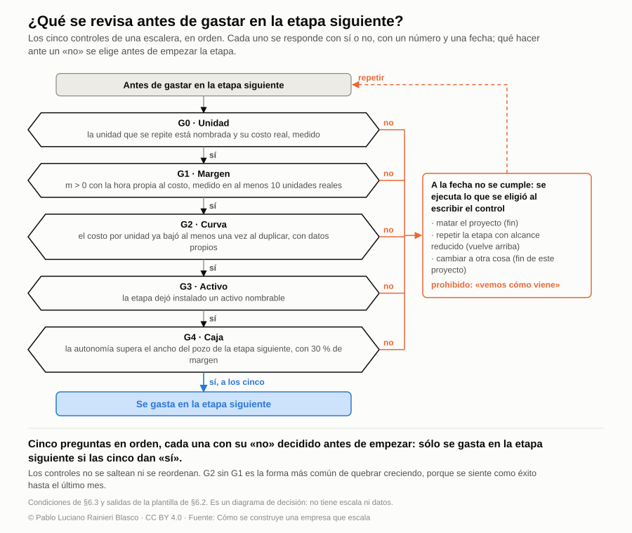

---

## PARTE 7 — LOS ERRORES QUE SE REPITEN

<div class="acertijo">

**El acertijo.** Una empresa compra un programa caro para hacer más rápido un trámite interno. Seis meses después, todo tarda lo mismo. Dar la explicación más probable antes de leer el error 3.

</div>

Doce modos de falla. Cada uno con su síntoma, su antídoto y un caso real.

1. **El volante dibujado.** Un diagrama circular sin un número en las flechas. *Antídoto:* nivel 4: número en dos flechas o admitirlo como hipótesis.
2. **La escala como tapa del margen.** «Con volumen se arregla.» El volumen multiplica el signo que ya se tenía. *Antídoto:* G1 antes que G2.
3. **Automatizar el paso que había que borrar.** Comprar una máquina o un programa para hacer más rápido algo que nadie revisó. *Antídoto:* receta R4.
4. **La plataforma sin cliente.** Construir la infraestructura de la etapa 3 estando en la 1. *Caso:* Webvan construyó depósitos antes de tener la demanda. *Antídoto:* G0 y la prueba del peldaño.
5. **El sueño sin promesa con fecha.** Una misión grande sin ninguna afirmación chica y verificable en el medio. Es el mismo mecanismo que produce fraudes: la misión grande consigue dinero y tolerancia al fracaso, y sirvió igual a SpaceX que a Theranos. *Antídoto:* misión grande, promesa chica, con fecha y que pueda resultar falsa en 90 días.
6. **La dependencia disfrazada de margen.** Un subsidio, un cliente único, un tipo de cambio o el trabajo no pago del dueño sosteniendo la cuenta. *Antídoto:* calcular el margen sin ese renglón.
7. **Confundir capital con clientes.** *Antídoto:* la prueba de los diez clientes (§3.5).
8. **Copiar el rasgo en vez del mecanismo.** Los plazos imposibles, la dureza con la gente, la sobreexposición pública, la apuesta total son **costos** que una posición dominante puede absorber. A escala pequeña son puro riesgo. *Antídoto:* copiar el mecanismo (restricción terminal, unidad, curva, lazo, controles), que es barato.
9. **El sesgo de supervivencia como plan.** Estudiar sólo al que ganó (Denrell 2003). *Antídoto:* por cada caso de éxito, buscar dos que hicieron algo parecido y desaparecieron (§2: Webvan, Kistler, Fisker, Better Place).
10. **El genio solo.** Una función excelente y otras en cero: el ingeniero sin venta, el vendedor sin producto. *Caso:* la Apple I sin Jobs ni Markkula era una placa para aficionados; la Lisa, un producto sin precio de mercado. *Antídoto:* la prueba de las seis funciones (§1.3).
11. **Casarse con la curva.** Bajar el costo especializando todo en un producto hasta no poder cambiarlo. *Caso:* Ford en 1927. *Antídoto:* cada cierto número de duplicaciones, preguntar qué cambió en el cliente.
12. **Crecer más rápido que la calidad.** *Caso:* Toyota, 2009-2010. *Antídoto:* el control de calidad escala antes que el volumen; si la tasa de defectos sube al crecer, se frena el crecimiento, no el control.

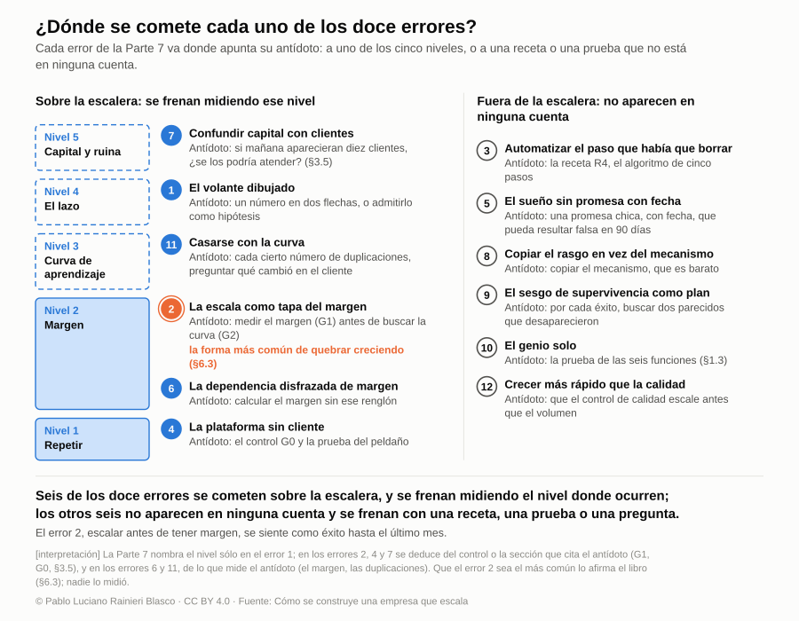

### 7.1 El error raíz: el número imposible usado para prometer

El plazo agresivo es una herramienta legítima de **diseño**: un objetivo imposible obliga a rediseñar el proceso entero, cosa que un objetivo razonable no obliga. El mismo número usado hacia afuera —con un cliente, un inversor, la familia— es una promesa que no se va a cumplir. La conducción autónoma anunciada «para el año que viene» durante años es el ejemplo más conocido, y no es un detalle de personalidad: **es el costo del método, y hay que contabilizarlo.**

> **El plazo agresivo va sobre el ciclo de aprendizaje, nunca sobre el compromiso con el cliente.** Adentro se apunta al número imposible porque obliga a borrar pasos. Afuera se compromete lo que se puede cumplir.

---

## PARTE 8 — POR QUÉ HAY TAN POCOS

<div class="acertijo">

**El acertijo.** Si los métodos de este libro son públicos —y lo son: ninguno es secreto—, ¿por qué hay tan pocas empresas como las de la Parte 2? Dar tres razones antes de seguir.

</div>

Tres capas. La segunda está bien establecida en la investigación; la primera y la tercera son hipótesis de este manual.

### 8.1 El resultado es un producto, no una suma

```
   resultado = habilidad operativa
               × capital inicial
               × apoyo externo al riesgo (contratos, créditos, compras públicas)
               × supervivencia a eventos de todo o nada
               × el momento del mercado
```

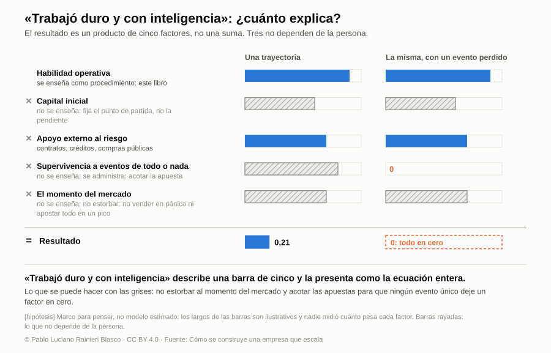

`[hipótesis]` Es un marco para pensar, no un modelo estimado: nadie midió cuánto pesa cada factor, y con cinco casos no se puede. Lo que dice es que si cualquier factor es cercano a cero, el resultado es cercano a cero, por excepcionales que sean los otros. Sin el capital de la venta de su empresa anterior no hay SpaceX en 2002; sin el contrato de diciembre de 2008, quiebra; sin el colchón de 2000, quizá no hay Amazon. **«Trabajó duro y con inteligencia» describe un factor de cinco y lo presenta como la ecuación entera.** `[interpretación]`

### 8.2 La cola invisible

De los cinco factores, tres no dependen de la persona. Entonces existe gente que hizo lo mismo, lo ejecutó igual de bien y perdió, porque le tocó un factor en cero. De esa gente no hay biografías. **La ausencia de esos casos no prueba que no existan: muestra cómo se elige de qué se escribe.** Denrell (2003) muestra el efecto: en una muestra de sobrevivientes, las prácticas riesgosas parecen asociadas al éxito aunque en la población completa no lo estén. Copiar el perfil de riesgo de un sobreviviente es copiar la varianza, no el resultado.

Es la respuesta al segundo acertijo, y conviene volver a la figura 21. De mil personas que apuestan todo a una moneda favorable, a las diez tiradas quedan unas seis, cada una con 1.024 veces su dinero. **Esas seis dan entrevistas y escriben libros. De las 994 restantes no hay biografías.** Quien estudie sólo a las seis va a concluir que apostar todo funciona.

### 8.3 La falla de transmisión, que es la que se puede atacar

`[hipótesis]` Descontadas las dos capas anteriores, este manual sostiene que queda algo real: **la habilidad operativa existe**, y en buena parte es un conjunto de ideas públicas —las de este manual—. ¿Por qué serían escasas? Porque los niveles 1 y 2 se transmiten solos y los niveles 3 a 5 no se transmiten por ningún canal popular: se enseñan en ingeniería industrial y en finanzas, en lenguajes que no se hablan entre sí, sin conectarlos con la ambición y sin un objeto visible. El caso NUMMI muestra que la falla ocurre incluso dentro de una misma empresa, con el ejemplo a la vista.

### 8.4 Qué se puede enseñar y qué no

| Factor | ¿Se puede enseñar? | Qué hacer con él |
|---|---|---|
| Capital inicial | No | Fija el punto de partida, no la pendiente |
| El momento del mercado | No | Lo único posible es no estorbar: no vender en pánico, no apostar todo en un pico |
| Supervivencia a eventos de todo o nada | No | Se **administra**: acotar la apuesta para que ningún evento único elimine |
| Tolerancia extrema al riesgo | En parte | **Se sustituye por estructura:** controles y apuestas acotadas hacen el mismo trabajo con mucha menos ruina |
| Misión y narrativa | En parte | Consigue dinero y tolerancia al fracaso (error 5); necesita el freno del §7.1 |
| **Las seis funciones, las cinco cuentas, las doce recetas** | **Sí, como procedimiento** | Este manual. Que se puedan enseñar no dice cuánto mejoran el resultado: eso no está medido |

**Tres cosas que se sostienen a la vez,** y que hay que sostener juntas para no caer en ninguno de los dos humos, el del genio y el de la pura suerte:

1. **La habilidad es real y el azar también.** Medida contra competidores financiados de forma parecida, la diferencia de ejecución existe. Y al mismo tiempo, tres de los cinco factores no dependen de nadie. «Fue sólo suerte» es un error tan grande como «fue sólo talento».
2. **El esfuerzo no achica el azar; la estructura sí.** Trabajar más no cambia la probabilidad de un evento de todo o nada. Lo que la administra es la forma de las apuestas: apuestas acotadas, que permiten sobrevivir para volver a tirar; muchos intentos baratos en lugar de uno caro; y la pendiente, que es propia. Esfuerzo sin estructura puede aumentar la exposición, no reducirla.
3. **Hacer todo bien sube las probabilidades y la pendiente. No garantiza la magnitud.**

### 8.5 La conclusión

> **La parte que se puede enseñar no da la magnitud. Da la pendiente.**

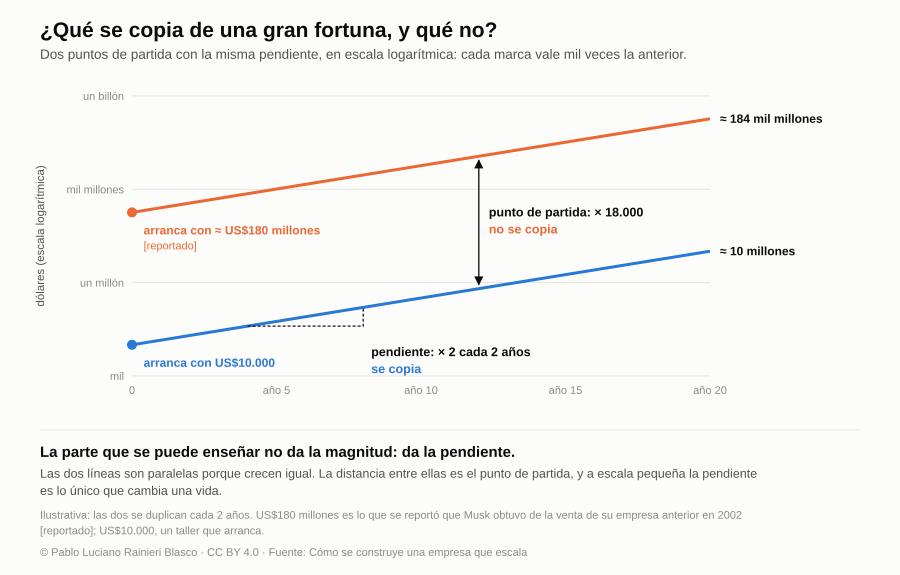

La magnitud depende de dónde se arrancó y de lo que tocó. La pendiente depende de la persona, y a escala pequeña es lo único que cambia una vida. No hace falta Marte: la ley de Wright funciona en una carpintería de cualquier ciudad, el cociente precio sobre material se calcula para cualquier producto, detener el trabajo ante un defecto se hace en cualquier taller, y los controles funcionan igual con mil dólares que con mil millones.

**La hipótesis, dicha corta** `[hipótesis]`: hay tan pocos porque la mayoría de quienes sueñan en grande se quedan en el nivel 2, y la mayoría de quienes dominan los niveles 3 a 5 no sueñan en grande. La combinación sería rara, no sobrehumana. Y las dos mitades se aprenden.

---

## PARTE 9 — HOJAS POR TIPO DE NEGOCIO

<div class="acertijo">

**El acertijo.** Quien tiene departamentos en alquiler, ¿debería aplicar la lógica de Ford y crecer para bajar el costo por unidad? Contestar sí o no, con el porqué, antes de mirar la tabla.

</div>

El esqueleto es el mismo; cambian la unidad, el activo y el control que más se saltea. Las curvas típicas son orientativas `[hipótesis]`, salvo en manufactura, donde la evidencia es abundante (Argote y Epple 1990).

| Tipo de negocio | La unidad | El activo del peldaño | Curva típica | El control que se saltea |
|---|---|---|---|---|
| **Servicio → producto** (consultoría, informes, diseño) | el encargo entregado | plantilla parametrizada, método escrito, catálogo | alta al principio, se aplana sin producto | **G3:** se factura años sin instalar un activo |
| **Oficio → taller** (carpintería, metalurgia, instalaciones) | la pieza o la instalación | molde, matriz, proceso, habilitación, proveedor propio | alta y sostenida si hay rediseño | **G1** con la hora propia al costo |
| **Manufactura** | la unidad fabricada | línea, herramental, sistema de calidad | alta: es donde nació la ley de Wright | **G4:** la fábrica se construye antes que la demanda |
| **Inmuebles** | el metro cuadrado alquilado | la unidad regularizada, el contrato tipo, el sistema de cobranza | **plana** | **G0:** se confunde ingreso con escalera; escala por capital, no por costo |
| **Programas y contenido** | el usuario o la pieza publicada | el código, la audiencia propia, el índice | altísima: costo marginal cerca de cero | **G1:** costo marginal cero no es margen positivo; queda el costo de conseguir cada cliente |
| **Comercio y reventa** | la transacción | proveedor exclusivo, logística, marca, datos de demanda | baja: el margen lo fija el proveedor | **G2:** no hay curva propia |

**La lectura que vale la tabla entera:** en los negocios de curva plana (inmuebles, reventa) la escala **no** baja el costo por unidad. La estrategia correcta ahí no es crecer para abaratar: es crecer para **acumular activo**, o no crecer. Aplicar la lógica de Ford o de SpaceX a un negocio de curva plana es el error de dominio más caro de este manual.

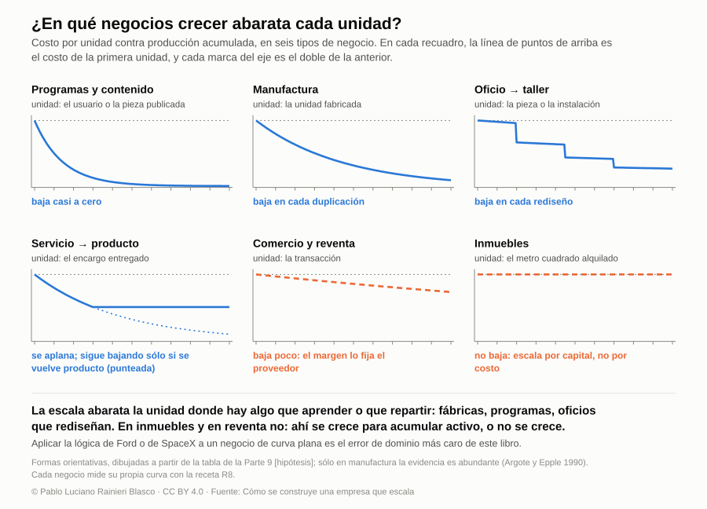

---

## PARTE 10 — EL PROTOCOLO: DE UNA IDEA A UNA ESCALERA

<div class="acertijo">

**El acertijo.** Un plan de negocio serio, ¿puede tener como primer paso «conseguir inversión»? Contestar antes de leer §10.2.

</div>

### 10.1 Las 12 preguntas de admisión

**Ninguna se saltea, y ninguna se contesta con un adjetivo.**

```
MISIÓN
 1. En una línea: ¿qué se quiere que sea verdad, y para cuándo?
 2. ¿Cuál es el NÚMERO FINAL que lo haría posible (un valor y una unidad)?
    Si ese número cambiara diez veces, ¿qué se haría distinto el lunes?

FUNCIONES
 3. De las seis funciones (§1.1), ¿cuál está en cero hoy, y quién la va a cubrir?

UNIDAD Y MARGEN
 4. ¿Cuál es la unidad que se repite (una palabra)?
 5. Por unidad: ¿cuánto entra y cuánto sale, con la hora propia al costo?
 6. ¿Cuántas unidades se hicieron ya? ¿Cuánto costó la primera y cuánto la última?

CURVA Y LAZO
 7. Entre esas dos, ¿bajó el costo? ¿Cuánto, y por qué exactamente?
 8. Si el precio baja 10 %, ¿cuánto sube la demanda (dato, estimación o "no se sabe")?
 9. ¿Cuántas duplicaciones faltan hasta el número final?

CAJA Y ACTIVO
10. ¿Cuánto dinero se pierde por mes hoy, y cuántos meses de caja hay?
11. ¿Qué queda INSTALADO cuando termine la etapa actual?
12. ¿Qué evento único sacaría del juego para siempre, y qué lo acota?
```

**Diagnóstico por las respuestas que faltan:**

- Falta la 2 → no hay misión, hay un deseo.
- Falta la 3 → no se sabe dónde está el cuello de botella.
- Falta la 5 → prohibido hablar de crecimiento hasta tenerla.
- Falta la 7 → no hay curva demostrada: toda proyección de costos es ficción.
- Falta la 11 → cinta de correr.
- Falta la 12 → riesgo de ruina sin acotar, el único error irreversible de la lista.

### 10.2 La forma obligatoria del plan

Un plan que no tenga estas ocho piezas no está terminado:

1. **Misión en una línea + número final.**
2. **La cadena hacia atrás** hasta una decisión de esta semana (receta R2).
3. **La tabla de las seis funciones**, con un nombre por renglón (§1.3).
4. **De 3 a 5 peldaños**, cada uno con: unidad · margen por unidad · activo que instala · costo · duración.
5. **Un control por peldaño**, con condición, fecha y la acción de fracaso ya elegida (§6.2).
6. **El conteo de duplicaciones** y el ritmo elegido (§5.1).
7. **La profundidad y el ancho del pozo** del peldaño siguiente, contra la autonomía real (§3.5).
8. **Las condiciones de abandono**, escritas hoy.

Y una regla de forma: **el peldaño 1 tiene que poder empezarse esta semana con el dinero que ya se tiene.** Un plan cuyo primer paso requiere financiamiento no es un plan: es un pedido de financiamiento disfrazado.

### 10.3 El pedido para un asistente de inteligencia artificial

Adjuntar este manual y pegar:

```
Usa el manual adjunto ("Cómo se construye una empresa que escala").

Mi idea o negocio es: __________________________________________

Haz esto, en este orden:
1. Recorre las 12 preguntas de admisión (Parte 10). Pregúntame las que no
   puedas responder con lo que te di. NO inventes ningún número: marca lo
   que falte como [FALTA DATO] y dime cuál bloquea el análisis.
2. Arma la tabla de las seis funciones y dime cuál está en cero.
3. Escribe la misión en una línea con su número final y baja la cadena
   hacia atrás hasta una decisión de esta semana.
4. Clasifica el negocio: ¿tiene curva de aprendizaje o es de curva plana
   (Parte 9)? Si es plana, dilo de entrada y cambia la estrategia.
5. Arma de 3 a 5 peldaños con la forma obligatoria (10.2).
6. Aplica los cinco controles (6.3) al peldaño 1 y dime cuál falla hoy.
7. Busca cuál de los 12 errores (Parte 7) estoy por cometer, aunque no lo pregunte.

Reglas: sin motivación ni adjetivos de entusiasmo; cada número con su estado
([dato] / [estimación] / [FALTA DATO]); si no pasa G1, dilo en el primer
párrafo y no sigas; si no escala, dilo: puede ser un buen negocio igual.
```

---

## PARTE 11 — LECCIONES DE OTRAS INDUSTRIAS

<div class="acertijo">

**El acertijo.** En 1956, cargar una tonelada de mercadería suelta en un barco costaba US$5,83. Malcom McLean no inventó ninguna máquina, y cargó la tonelada por mucho menos. ¿Cuánto, y qué cambió? Está en la ficha B4.

</div>

Los métodos de este libro no nacieron en cinco empresas. La aviación, la defensa, la medicina, la informática y la logística resolvieron problemas parecidos antes, y dejaron casos medidos. Esta parte junta veintiséis, en siete familias.

**El filtro de entrada.** Una lección entró sólo si tenía tres cosas: un caso documentado con un número, una fuente original con su año, y **un caso en que la regla falla**. Se descartaron veintiuna candidatas famosas que no pasaron el filtro —entre ellas KISS, el ciclo OODA, la intención del comandante y «ningún plan sobrevive al contacto con el enemigo»—, porque sin caso medido una regla es una frase célebre, y sin contraejemplo es propaganda.

**Cómo leer cada ficha.** Cinco renglones: la **regla**; el **caso**, con su número y su estado (la misma convención del resto del libro); la **fuente** original; **cuándo falla**, que es obligatorio; y cómo se usa **a escala pequeña**, en un taller, un local o un servicio. Las fuentes que se leyeron para verificar cada ficha están en el Anexo C.

**Estado.** Las fichas se verificaron contra fuentes en octubre de 2026. Una revisión al azar de tres fichas encontró dos imprecisiones. Eso obligó a revisar las veintiséis una por una, de nuevo contra la fuente, el 21 de octubre, y la revisión corrigió detalles en catorce más: una fecha, una atribución, un número desactualizado, un conteo que la fuente no sostenía. Ninguna corrección cambió una regla. Todas están incorporadas.

### A · Simplificar

#### A1 · La mejor pieza es la que no existe

**Regla.** **Antes de abaratar una pieza, preguntar si tiene que existir: sólo existe si se mueve respecto de las demás, si tiene que ser de otro material o si hay que separarla para armar o desarmar.**

**Caso.** NCR rediseñó su terminal de punto de venta 2760 con ese método: 85 % menos piezas, 75 % menos tiempo de armado, ninguna herramienta de armado y 65 % menos proveedores. Se estimó que sacar un solo tornillo ahorraba hasta US$12.500 en la vida del producto `[verificado, primaria — Boothroyd, Dewhurst y Knight 2002, §1.5.4]`.

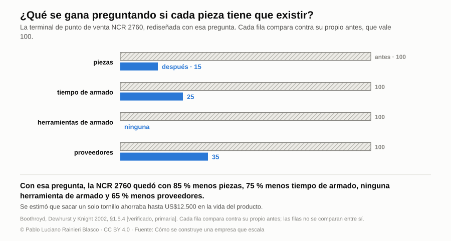

**Fuente.** Geoffrey Boothroyd y Peter Dewhurst, diseño para el ensamblaje: métodos analíticos desde 1977; manual *Product Design for Assembly*, 1990.

**Cuándo falla.** Juntar piezas puede encarecer la reparación. En el Model Y, Tesla reemplazó por una sola pieza fundida la parte trasera que en el Model 3 llevaba unas 70 piezas `[reportado — cuenta de la propia Tesla]`. En 2023, Reuters encontró que la mayoría de más de 120 Model Y dados por pérdida total y rematados tenían menos de 16.000 km; el aviso de remate de un Model Y de US$61.388 estimaba la reparación en US$50.388 `[reportado — Reuters, enero de 2023]`. El tercer criterio del método existe por esto: la pieza que hay que separar para reparar no se elimina. Un estudio de 2025 midió lo contrario: con reemplazo parcial, la pieza trasera fundida salió £2.167 (unos US$2.900) más barata de reparar que la trasera de varias piezas del Model 3; con reemplazo total, la diferencia bajó a £519 `[reportado — Thatcham Research, septiembre de 2025]`. La disputa sigue abierta.

**A escala pequeña.** Un taller de muebles cuenta los tornillos, herrajes y piezas de cada modelo y pasa cada uno por las tres preguntas. Lo que no las pasa se integra en otra pieza o se elimina, salvo que el cliente tenga que poder desarmarlo.

#### A2 · Hacer una cosa y hacerla bien

**Regla.** **Resolver con herramientas chicas que hacen una sola cosa y se encadenan, antes de escribir una solución única desde cero.**

**Caso.** En 1986, Jon Bentley pidió a Donald Knuth un programa que contara las palabras más frecuentes de un texto. Knuth entregó un programa de varias páginas, impecable y documentado con su método de programación literaria. Doug McIlroy lo resolvió con seis comandos de Unix encadenados, escritos en el momento, que funcionaron al primer intento y procesaron un archivo de 10.000 palabras en 30 segundos en una VAX-11/750 `[verificado, primaria — Bentley, Knuth y McIlroy 1986]`.

**Fuente.** Doug McIlroy, con E. N. Pinson y B. A. Tague, prólogo al número de Unix del *Bell System Technical Journal*, 57(6), 1978 («haga cada programa una sola cosa, y hágala bien»); Richard Gabriel, «peor es mejor», 1989.

**Cuándo falla.** El propio McIlroy lo advierte en la misma reseña: su método de ordenar todo «es potencialmente menos eficiente». Para un trabajo de producción, como uno para la Biblioteca del Congreso, la cadena sería sólo «un buen anticipo». Si hiciera falta más, propone contar las palabras en una tabla antes de ordenarlas, que se acerca a la estructura de Knuth, y estima una aceleración de un orden de magnitud. La cadena de herramientas sirve para tener la respuesta hoy; a gran volumen, gana la solución integrada.

**A escala pequeña.** Un local arma su sistema con una planilla para pedidos, otra para stock y un mensaje automático, antes de pagar un sistema a medida. Lo integra cuando el volumen hace que pasar datos a mano cueste más que el sistema.

### B · El precio o el requisito heredado

#### B1 · Costo más honorario contra precio fijo

**Regla.** **Antes de discutir el precio, mirar el contrato: con costo más honorario, el que gasta de más cobra más; con precio fijo, el que ahorra se queda con el ahorro.**

**Caso.** Con los mismos datos técnicos corregidos, la NASA estimó el desarrollo del Falcon 9 en US$1.383 M a costo más honorario y en US$443 M a precio fijo: un factor tres, sólo por el contrato `[verificado, primaria — NASA 2011]`. Está desarrollado en §2.5; esta ficha agrega el contraejemplo.

**Fuente.** Contratación pública estadounidense; la comparación cuantitativa es de NASA 2011.

**Cuándo falla.** El precio fijo traslada el riesgo al fabricante, y si el requisito no está maduro, lo funde. Boeing ganó a precio fijo el avión cisterna KC-46 y acumulaba más de US$7.000 M en cargos por pérdidas en 2023 `[verificado, secundaria — Breaking Defense, abril de 2023]`. El precio fijo sirve cuando el que cotiza sabe hacer la cosa; cuando hay que inventarla, alguien paga la incertidumbre igual.

**A escala pequeña.** Un taller que cotiza «a precio cerrado» un trabajo que nunca hizo cobra el aprendizaje de su bolsillo. Conviene cerrar precio sólo en lo repetido, y cobrar por hora más un tope en lo nuevo.

#### B2 · La ley de Augustine

**Regla.** **Si cada generación de producto agrega requisitos sin sacar ninguno, el costo por unidad crece exponencialmente, más rápido que el presupuesto de quien lo compra.**

**Caso.** En 1979, Norman Augustine midió que el costo unitario de cada generación nueva de aviones de combate estadounidenses crecía alrededor de un orden de magnitud (diez veces) cada veinte años desde 1910. Extrapolado, en 2054 todo el presupuesto de defensa alcanzaría para un solo avión. En 2024, el CSIS actualizó los datos: el F-35 llegó a un costo promedio de US$140 M en 2016, sin contar desarrollo ni mantenimiento, y la tendencia sigue `[verificado, secundaria — CSIS 2024, que reproduce el estudio de 1979]`.

**Fuente.** Norman Augustine, *Defense Systems Management Review*, 2(2), 1979; *Augustine's Laws*, 1984 (ley XVI).

**Cuándo falla.** La ley compara generaciones, no lotes. Dentro de una misma generación, el volumen baja el costo: el F-35A costaba más de US$200 M en los primeros ejemplares y menos de US$80 M en los lotes 13 y 14 (2019) `[verificado, primaria — Lockheed Martin, 29-oct-2019; el valor inicial es reportado]`. Tampoco rige donde alguien borra requisitos: es la apuesta del CSIS con los aviones sin piloto.

**A escala pequeña.** Antes de lanzar la versión nueva de un producto, listar qué requisito se agregó y cuál se sacó. Si sólo se agregan, el precio va a subir más rápido que lo que el cliente está dispuesto a pagar.

#### B3 · Desarmar el producto del competidor

**Regla.** **Para saber cuánto cuesta hacer algo, desarmar pieza por pieza el producto de quien ya lo hace y costear cada pieza.**

**Caso.** En 2018, Munro & Associates desarmó un Tesla Model 3 y estimó para el auto un margen bruto de más del 30 % `[reportado — Electrek, 16-jul-2018]`.

**Fuente.** Sandy Munro, Munro & Associates (desarme y costeo de productos). El método de fondo es el análisis de valor de Miles (1947), ya citado en la tesis de este libro.

**Cuándo falla.** El desarme muestra el costo de las piezas, no el de la fábrica. Para el mismo trimestre, Tesla informó un margen del Model 3 de «más del 20 %», no del 30 % `[verificado, primaria — Tesla, informe del 3.er trimestre de 2018]`. El desperdicio, el retrabajo y la puesta en marcha no aparecen en la pieza. Y la primera impresión del propio Munro sobre la calidad del auto había sido negativa, y él mismo la corrigió después del desarme.

**A escala pequeña.** Una panadería compra el producto estrella de la competencia, lo pesa, lo separa por ingredientes y lo costea. Al resultado le suma la merma y las horas propias, que el producto no muestra.

#### B4 · Cambiar la unidad: el contenedor

**Regla.** **Cuando el costo está en manipular la carga y no en transportarla, no se optimiza la manipulación: se cambia la unidad que se manipula.**

**Caso.** El 26 de abril de 1956, el *Ideal X* de Malcom McLean salió de Newark con 58 cajas de camión. Cargar una tonelada suelta en un barco mediano costaba US$5,83; los contadores de McLean calcularon el costo del *Ideal X* en 15,8 centavos por tonelada, 37 veces menos `[verificado, secundaria — Levinson 2006, en extracto del autor]`.

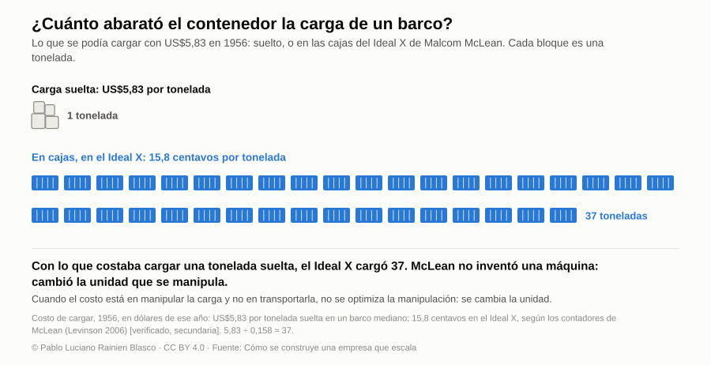

**Fuente.** Marc Levinson, *The Box*, 2006.

**Cuándo falla.** Acertar con la unidad no protege de errar con la apuesta siguiente. En 1978 McLean compró United States Lines y construyó los portacontenedores más grandes de su época, diseñados para petróleo caro: lentos y económicos en combustible. El petróleo se abarató y la empresa quebró en 1986 `[verificado, secundaria]`.

**A escala pequeña.** Una verdulería que arma pedidos a domicilio pasa de pesar producto por producto a cajones estándar por tamaño de hogar: se cobra, se arma y se carga por cajón.

### C · Iterar

#### C1 · El banco de pruebas propio

**Regla.** **Si los datos publicados no coinciden con lo que se mide, construir un banco de pruebas propio, barato, y medir.**

**Caso.** En 1901, el planeador de los hermanos Wright levantaba un tercio de lo que predecían sus cálculos con los datos de Lilienthal. Construyeron un túnel de viento, probaron entre cien y doscientos modelos de ala, y eligieron unos 30 para un estudio detallado. Además corrigieron el coeficiente de Smeaton, de 0,005 a cerca de 0,0033 `[verificado, secundaria — NASA Glenn Research Center; Smithsonian]`. Según el Smithsonian, el error no estaba en la tabla de Lilienthal sino en cómo la aplicaban.

**Fuente.** Wilbur y Orville Wright, 1901.

**Cuándo falla.** Un banco propio también puede estar mal, y si es el único, nadie lo nota. El espejo del telescopio Hubble se pulió a la perfección con la forma equivocada. El instrumento de control tenía un error de 1,3 mm, y un segundo instrumento independiente había dado otro resultado, que se descartó como «menos preciso» `[verificado, secundaria — Comisión Allen 1990, vía The Baltimore Sun]`. La reparación se hizo en órbita en 1993.

**A escala pequeña.** Un taller que fabrica una mezcla, una pieza o una receta mide su propio rendimiento en vez de creerle a la ficha técnica, y lo cruza con un segundo método. Si los dos no coinciden, se para hasta saber por qué.

#### C2 · Probar todo junto

**Regla.** **Si cada vuelo de prueba es caro y lento, probar el sistema completo de una vez, con una campaña exhaustiva de ensayos en tierra detrás.**

**Caso.** El 1 de noviembre de 1963, George Mueller ordenó que el Saturn V volara por primera vez con las tres etapas activas. La alternativa eran cuatro vuelos por etapas, doce meses más y «cientos de millones de dólares». El primer vuelo, Apollo 4, funcionó en noviembre de 1967 `[verificado, primaria — Bilstein, *Stages to Saturn*, NASA SP-4206, 1980, cap. 12]`.

**Fuente.** George Mueller, NASA, 1963; lo traía de los misiles de la Fuerza Aérea (Titan II y Minuteman).

**Cuándo falla.** Sin ensayos en tierra, probar todo junto es apostar. El cohete lunar soviético N1 nunca encendió completa en banco su primera etapa de treinta motores. Fue lanzado cuatro veces entre 1969 y 1972, y las cuatro falló `[verificado, secundaria]`. La historia oficial de la NASA cita a un observador que lo llamó «una apuesta calculada», respaldada por «el programa de ensayos en tierra más exhaustivo de la historia aeroespacial».

**A escala pequeña.** Un local nuevo hace una noche de prueba completa, con cocina, caja y reparto a la vez, en vez de probar cada parte por separado durante semanas. Pero antes prueba cada equipo en vacío.

#### C3 · Caminos en paralelo

**Regla.** **Cuando no se sabe qué tecnología va a funcionar y el plazo importa más que el costo, financiar varias a la vez y elegir por resultado.**

**Caso.** El Proyecto Manhattan siguió en simultáneo tres métodos de enriquecimiento de uranio (electromagnético, difusión gaseosa y difusión térmica), una centrífuga y la vía del plutonio. La centrífuga se abandonó en noviembre de 1942; los otros tres contribuyeron, encadenados: en febrero de 1943 Groves propuso usar la salida de unas plantas como entrada de otras, y desde marzo de 1945 los tres procesos funcionaron en serie. El costo fue de casi US$2.000 M de la época `[verificado, secundaria — historia oficial resumida en Wikipedia; Wellerstein]`.

**Fuente.** General Leslie Groves y la dirección del Proyecto Manhattan, 1942-1945.

**Cuándo falla.** Los caminos en paralelo necesitan un árbitro que corte. La URSS tuvo oficinas de diseño compitiendo sin una decisión central: el primer decreto sobre el programa lunar tripulado llegó en agosto de 1964, tres años después del de Kennedy, y repartió el trabajo entre dos oficinas rivales `[verificado, secundaria — Siddiqi, *Challenge to Apollo*, NASA SP-4408, 2000]`.

**A escala pequeña.** Un emprendimiento que no sabe qué canal de venta funciona prueba dos o tres en paralelo durante un mes, con un tope de gasto para cada uno y una fecha para cortar los que no rinden.

#### C4 · Ensayar el proceso a escala real, con tiza

**Regla.** **Antes de construir la cocina, el taller o la línea, dibujarla en el piso a tamaño real y ensayar los movimientos.**

**Caso.** En 1948 los hermanos McDonald cerraron tres meses. Redujeron el menú a nueve productos y bajaron los precios a la mitad (hamburguesa a 15 centavos). En 1952, para el edificio nuevo, dibujaron con tiza en una cancha de tenis la medida real de cada equipo de cocina `[verificado, secundaria — Hess 1986; PBS SoCal]`.

**Fuente.** Richard y Maurice McDonald, con el arquitecto Stanley Meston y su asistente Charles Fish; documentado por Alan Hess, *Journal of the Society of Architectural Historians*, 45(1), 1986.

**Cuándo falla.** El ensayo prueba los movimientos, no la demanda. Al reabrir en 1948, las ganancias se desplomaron al principio: los clientes del autoservicio con camareras no volvieron, y tardó en llegar el público nuevo de familias `[reportado — PBS SoCal; Love 1986, vía fuentes secundarias]`.

**A escala pequeña.** Antes de mudar o rearmar un local, marcar con cinta en el piso el refrigerador, la mesa de trabajo y la caja, y hacer un pedido completo caminando. Lo que choca en el piso choca después en la obra.

#### C5 · Producto mínimo

**Regla.** **Antes de construir el producto, mostrar lo mínimo que permite saber si alguien lo quiere, y medir la respuesta.**

**Caso.** En 2007-2008, Drew Houston publicó un video de tres minutos de Dropbox, que todavía no existía como producto terminado. La lista de espera pasó de unas 5.000 a 75.000 personas en un día `[reportado — relato del propio Houston a TechCrunch, 2011]`.

**Fuente.** Steve Blank, *The Four Steps to the Epiphany*, 2005 (desarrollo de clientes); Eric Ries, *The Lean Startup*, 2011.

**Cuándo falla.** Donde el producto puede dañar a alguien, «mínimo» no puede querer decir «sin validar». Theranos ofrecía más de 240 análisis de sangre, pero en diciembre de 2014 hacía sólo unos 15 en su propio equipo y el resto en máquinas comerciales, sin decirlo `[verificado, primaria — The Wall Street Journal, 15-oct-2015]`.

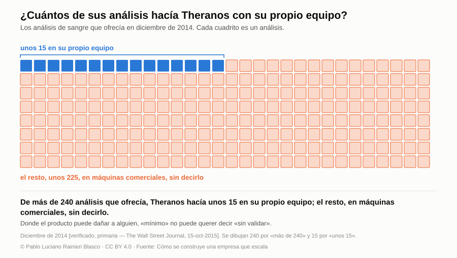

**A escala pequeña.** Un taller que piensa en un producto nuevo publica fotos y precio y toma anticipos antes de comprar la materia prima. Si no hay anticipos, no hay producto.

### D · Decidir

#### D1 · ¿Qué haría el que me reemplace?

**Regla.** **Para cortar con un negocio en el que hay historia y orgullo, preguntar qué haría alguien nuevo en el puesto, sin esa historia, y hacerlo uno mismo.**

**Caso.** A mediados de 1985, Intel perdía dinero con las memorias frente a los fabricantes japoneses, y su participación en el mercado había caído a 1,3 % en 1984. Andy Grove le preguntó a Gordon Moore qué haría un director nuevo. «Nos sacaría de las memorias.» Grove respondió: «¿Por qué no salimos por esa puerta, volvemos a entrar y lo hacemos nosotros?». Intel anunció su salida de las memorias en octubre de 1985 y se concentró en los microprocesadores `[verificado, secundaria — Grove 1996; SemiWiki]`.

**Fuente.** Andy Grove, *Only the Paranoid Survive*, 1996.

**Cuándo falla.** La mirada del recién llegado no sabe lo que el cliente valora. A fines de 2011, Ron Johnson llegó a J.C. Penney desde Apple, y en 2012 eliminó cupones y liquidaciones. Las ventas cayeron 25 % y la empresa perdió US$985 M en el año; la empresa volvió a llamar al director anterior `[verificado, secundaria — JCK, con los resultados del ejercicio 2012]`.

**A escala pequeña.** Una vez por año, escribir en una hoja qué cambiaría alguien que comprara el negocio mañana. Separar lo que no se cambia por buenas razones de lo que no se cambia por costumbre.

#### D2 · Imaginar que ya fracasó

**Regla.** **Antes de empezar, suponer que el proyecto ya fracasó y que cada uno escriba por qué.**

**Caso.** Mitchell, Russo y Pennington (1989) midieron que imaginar un hecho como ya ocurrido, en vez de como posible, aumenta en cerca de 30 % la **cantidad** de razones que se generan. En 2016, un estudio con 101 gerentes de programa e ingenieros encontró que los equipos que usaron el método identificaron más riesgos plausibles que los que hicieron una lluvia de ideas `[verificado, secundaria — Collins, notas de curso, con las citas originales]`.

**Fuente.** Deborah Mitchell, J. Edward Russo y Nancy Pennington, *Journal of Behavioral Decision Making*, 2(1), 1989; Gary Klein, «Performing a Project Premortem», *Harvard Business Review*, 2007.

**Cuándo falla.** Klein cita el 30 % como «capacidad de identificar correctamente las razones», pero el estudio midió cantidad, no acierto. Además, en Veinott, Klein y Wiggins (2010), después de proponer soluciones a las fallas imaginadas, la confianza subió más en el grupo que había usado el método que en los otros. El ejercicio puede terminar dando una tranquilidad que no está justificada.

**A escala pequeña.** Antes de firmar el alquiler de un local, sentarse con el socio, escribir «cerramos en un año: ¿por qué?» y anotar diez razones. A cada una le corresponde una prueba barata antes de firmar, no una promesa.

#### D3 · Comparar contra proyectos parecidos

**Regla.** **Estimar plazo y costo mirando cómo terminaron proyectos parecidos, no desmenuzando el propio.**

**Caso.** En la base de Bent Flyvbjerg, de más de 16.000 proyectos, sólo el 8,5 % cumple costo y plazo, y sólo el 0,5 % cumple costo, plazo y beneficio prometido `[verificado, secundaria — Flyvbjerg y Gardner 2023, vía reseñas]`. Daniel Kahneman cuenta que su equipo estimó en dos años un libro de texto escolar. Los proyectos parecidos tardaban de 7 a 10 años, y el 40 % nunca terminaba. Tardaron ocho `[verificado, secundaria — Kahneman 2011]`.

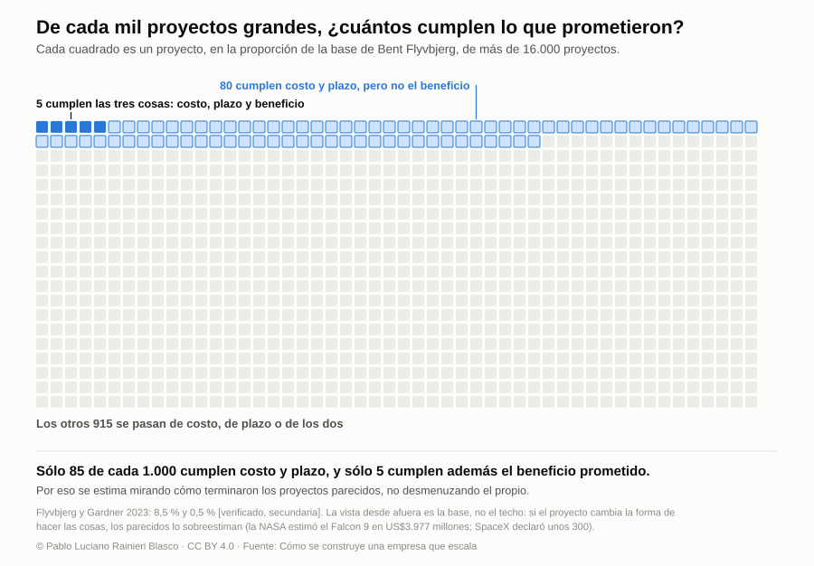

**Fuente.** Daniel Kahneman y Amos Tversky, «Intuitive prediction: biases and corrective procedures», 1979 (visión desde afuera); Bent Flyvbjerg y Dan Gardner, *How Big Things Get Done*, 2023.

**Cuándo falla.** Si el proyecto cambia la forma de hacer las cosas, los proyectos parecidos lo sobreestiman. La NASA estimó el Falcon 9 con un modelo construido sobre sus programas anteriores: US$3.977 M. SpaceX declaró ≈ US$300 M `[verificado, primaria — NASA 2011; Zapata 2017]`. La visión desde afuera es la base, no el techo.

**A escala pequeña.** Antes de prometer una fecha de apertura, preguntar a tres comercios del barrio cuánto tardó la suya respecto de lo planeado. Sumarle a la propia estimación la demora promedio.

#### D4 · La falacia del Concorde

**Regla.** **Decidir si seguir mirando lo que falta gastar y lo que se va a obtener, no lo que ya se gastó.**

**Caso.** El Concorde se estimó en £70 millones en 1962 y terminó costando entre £1.500 y £2.100 millones en 1976. Se esperaban 350 aviones y se construyeron 20 `[verificado, secundaria — Wikipedia, con fuentes]`. Dawkins y Carlisle bautizaron el error con su nombre en 1976.

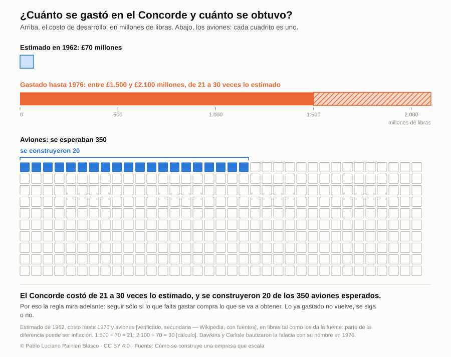

**Fuente.** Richard Dawkins y Tamsin Carlisle, *Nature*, 262, 1976; Hal Arkes y Peter Ayton, *Psychological Bulletin*, 1999.

**Cuándo falla.** No todo seguir es falacia. Los tres primeros vuelos del Falcon 1 fallaron, y SpaceX hizo un cuarto con el último dinero. Funcionó, y en tres meses llegó el contrato de la NASA (§2.5). Seguir es correcto cuando lo que falta gastar compra una probabilidad razonable de éxito; es falacia cuando sólo justifica lo gastado.

**A escala pequeña.** Ante una máquina, un local o un producto que no rinde, preguntar: «si hoy no lo tuviera, ¿lo compraría a este precio?». Si la respuesta es no, lo ya pagado no es argumento.

### E · Organizar gente

#### E1 · Las reglas de Skunk Works: equipo chico, aislado, con autoridad

**Regla.** **Para un proyecto urgente y nuevo, un equipo chico de gente buena, separado de la burocracia, con un jefe que decide y pocos informes.**

**Caso.** En junio de 1943, Kelly Johnson armó un equipo propio en Lockheed. El XP-80, primer avión a reacción de combate de Estados Unidos, se diseñó y construyó en 143 días, siete menos de lo exigido. El contrato formal llegó el 16 de octubre, cuatro meses después de empezar `[verificado, primaria — Lockheed Martin]`.

**Fuente.** Clarence «Kelly» Johnson, Skunk Works de Lockheed, 1943; sus 14 reglas y prácticas.

**Cuándo falla.** Un equipo aislado puede inventar algo que la empresa no sabe vender. En 1973, el PARC de Xerox tenía funcionando la Alto, con ventanas, ratón y red. Xerox la comercializó recién en 1981, como la Star, a US$16.595, y la discontinuó en 1985. Apple vio la Alto en 1979 `[verificado, secundaria — precio: Wikipedia, que cita al Museo Nacional de Historia Estadounidense (Smithsonian); visita de Apple: Computer History Museum; el fracaso comercial: Smith y Alexander 1988, reportado]`. El aislamiento acelera la invención; el traspaso al negocio hay que diseñarlo aparte.

**A escala pequeña.** Para lanzar un producto nuevo en un taller, separar a dos personas durante un mes, con presupuesto propio y autoridad para comprar sin pedir permiso. Desde el día uno, alguien de ventas mira qué están haciendo.

#### E2 · La ley de Brooks

**Regla.** **Sumar gente a un proyecto atrasado lo atrasa más: los nuevos tienen que aprender, y cada persona más agrega canales de coordinación.**

**Caso.** Fred Brooks dirigió el sistema operativo OS/360 de IBM, un proyecto de unos 5.000 años-hombre, y publicó la ley en *The Mythical Man-Month*, 1975 `[verificado, secundaria]`. Con *n* personas hay *n*(*n* − 1)/2 canales posibles: 10 con 5 personas, 45 con 10.

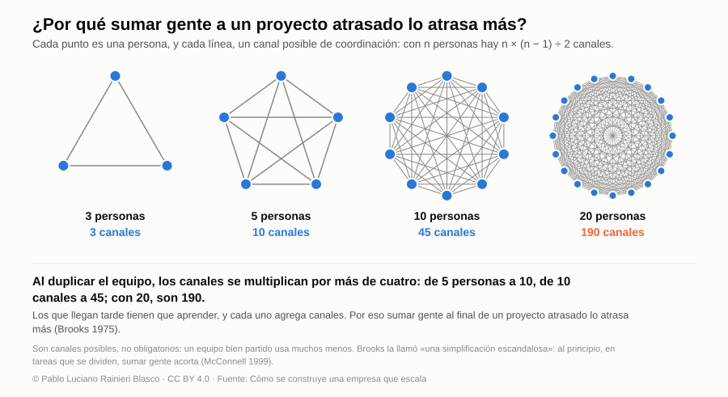

**Fuente.** Frederick P. Brooks, *The Mythical Man-Month*, 1975; edición de aniversario, 1995.

**Cuándo falla.** El propio Brooks la llamó «una simplificación escandalosa». Steve McConnell (*IEEE Software*, 1999) muestra que sumar gente temprano, cuando el trabajo se puede dividir, no cae bajo la ley y puede ayudar. El Laboratorio de Ingeniería de Software de la NASA recomendaba empezar con pocos y sumar gente después de definir requisitos y arquitectura. La ley rige al final y en tareas que no se dividen.

**A escala pequeña.** Si un pedido grande viene atrasado a una semana de la entrega, contratar a alguien nuevo no ayuda: ayuda sacarle al equipo todo lo que no es ese pedido. Al principio del pedido, en cambio, sumar una persona para las tareas separables sí acorta.

#### E3 · La ley de Conway

**Regla.** **El producto copia la estructura de comunicación de la organización que lo hace: para cambiar la arquitectura del producto, hay que cambiar la de los equipos.**

**Caso.** MacCormack, Rusnak y Baldwin compararon pares de programas de tamaño y función parecidos, uno hecho por una organización muy unida y otro por una distribuida. En todos los pares, el de la organización distribuida era más modular. En el par de programas de gestión financiera, un cambio en una parte podía afectar al 47,1 % del programa comercial y sólo al 7,7 % del abierto: seis veces más `[verificado, primaria — versión de trabajo de Harvard, 2008, publicada en *Research Policy*, 2012]`.

**Fuente.** Melvin Conway, «How Do Committees Invent?», *Datamation*, abril de 1968.

**Cuándo falla.** No es universal. Colfer y Baldwin revisaron 142 estudios: en empresas e industrias el espejo es frecuente, pero en los proyectos colaborativos abiertos el 56 % de los estudios descriptivos no lo encuentra `[verificado, secundaria — *Industrial and Corporate Change*, 2016]`. Con herramientas compartidas y código visible, la comunicación deja de seguir el organigrama.

**A escala pequeña.** Si en un local la cocina y el salón no se hablan, el menú va a tener platos que el salón no sabe vender. Antes de rediseñar el menú, se junta a las dos partes.

#### E4 · La certificación física (Rickover, SUBSAFE)

**Regla.** **Donde la falla es irreversible, el requisito no se borra: se certifica cada pieza crítica con evidencia física y se registra. Es el contrapeso de «borrar antes que optimizar».**

**Caso.** El 10 de abril de 1963, el submarino nuclear *Thresher* se hundió en pruebas de inmersión profunda con 129 personas. En junio de 1963, dos meses después, la Marina creó SUBSAFE, que certifica con evidencia objetiva cada sistema que mantiene el agua afuera. Desde entonces no se perdió ningún submarino certificado. El *Scorpion*, perdido en 1968, no tenía la certificación, y según la misma fuente SUBSAFE no habría evitado esa pérdida `[verificado, secundaria — NASA, mensaje de seguridad 2006; Leveson 2011, cap. 14]`.

**Fuente.** Marina de Estados Unidos, programa SUBSAFE, 1963, en la cultura de rigor técnico que impuso Hyman Rickover en la propulsión nuclear naval.

**Cuándo falla.** La certificación vale lo que vale lo que mide. El 737 MAX estaba certificado: el sistema MCAS dependía de un solo sensor de ángulo de ataque, y su certificación se delegó en el propio fabricante. Dos accidentes mataron a 346 personas `[verificado, primaria — informe final de la Comisión de Transporte e Infraestructura de la Cámara de Representantes, redactado por la mayoría, septiembre de 2020]`. Si el papel reemplaza a la prueba física, certificar no protege.

**A escala pequeña.** Un taller que hace instalaciones de gas o estructuras no «simplifica» la prueba de presión ni el ensayo de carga. Lo documenta con foto y número en cada trabajo, aunque el cliente no lo pida.

### F · Seguridad y error

#### F1 · La lista de verificación

**Regla.** **En una tarea que el experto domina pero en la que un olvido es grave, usar una lista corta que se lee en voz alta en los momentos críticos.**

**Caso.** El 30 de octubre de 1935, el prototipo del B-17 se estrelló al despegar porque la tripulación olvidó destrabar los controles; murieron el piloto y el piloto de pruebas jefe de Boeing, que iba detrás como asesor. De ahí salió la lista de verificación del piloto `[verificado, secundaria]`. En 2009, una lista de verificación de la OMS aplicada en ocho hospitales de ocho países bajó la mortalidad quirúrgica de 1,5 % a 0,8 % y las complicaciones de 11 % a 7 %, en 7.688 pacientes `[verificado, primaria — Haynes y otros, *NEJM*, 2009]`.

**Fuente.** Boeing y el Cuerpo Aéreo del Ejército, 1935; Alex Haynes, Atul Gawande y otros, *New England Journal of Medicine*, 360, 2009.

**Cuándo falla.** Impuesta por obligación, sin entrenamiento ni convicción, no mueve el resultado. En Ontario, donde la lista se volvió obligatoria en 101 hospitales, la mortalidad pasó de 0,71 % a 0,65 %, una diferencia no significativa `[verificado, primaria — Urbach y otros, *NEJM*, 2014]`. La lista funciona cuando el equipo la usa de verdad, no cuando se firma.

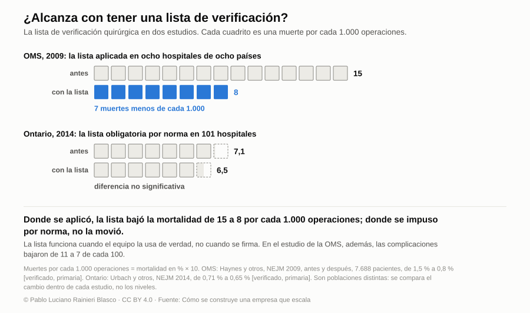

**A escala pequeña.** Antes de entregar un trabajo, una lista de cinco puntos que se lee con el cliente, por ejemplo: medidas, terminación, limpieza, garantía y cobro. Cinco puntos, no cincuenta.

#### F2 · Reportar el error sin castigo

**Regla.** **Para enterarse de los casi-accidentes, quien los reporta tiene que estar protegido: confidencialidad y, dentro de límites, inmunidad.**

**Caso.** En abril de 1976, la NASA y la FAA crearon el ASRS, un sistema de reportes voluntarios con confidencialidad e inmunidad limitada ante sanciones. Lleva más de dos millones de reportes y, según la NASA, nunca reveló la identidad de quien reportó `[verificado, secundaria — SKYbrary; NASA, material de difusión del ASRS, 2024]`.

**Fuente.** NASA y FAA, Aviation Safety Reporting System, 1976; circular de la FAA AC 00-46.

**Cuándo falla.** Reportar no alcanza si nadie actúa. Antes del accidente del *Columbia* (2003), los restos desprendidos del tanque externo habían dañado algo en todos los vuelos anteriores, casi siempre poco, y la espuma de la rampa del soporte izquierdo ya se había desprendido en varios vuelos, el último tres meses antes. Se volvió normal, y en el vuelo 107 un trozo de esa espuma perforó el ala `[verificado, secundaria — Junta de Investigación del Accidente del Columbia, 2003, vía Wikipedia y las conferencias de prensa de la Junta]`. Diane Vaughan lo llamó «normalización del desvío».

**A escala pequeña.** Un cuaderno en el taller donde cualquiera anota «casi me corto», «casi mandamos mal el pedido», sin buscar culpables. Una vez por semana se toma el reporte más repetido y se cambia algo concreto.

#### F3 · Recortar costo: hasta dónde

**Regla.** **Recortar costo funciona hasta que recorta la verificación que atrapaba el error; ese límite se escribe antes de recortar.**

**Caso.** Con «más rápido, mejor, más barato» (Daniel Goldin, NASA, 1992-2001), la NASA lanzó 16 misiones, todas por menos que la sola sonda Cassini. Diez salieron bien. Mars Pathfinder costó cerca de US$200 M, el 6,7 % de lo que costó Viking. En 1999 se perdieron las dos sondas de Mars Surveyor 98, con un costo total de unos US$327,6 M. Una se perdió porque un programa entregaba unidades inglesas y el otro esperaba métricas. La evaluación independiente de 2000 (informe Young) concluyó que hacen falta márgenes adecuados y que «un programa completo de ensayos y verificación es esencial», y Goldin reconoció que habían llevado el método demasiado lejos `[verificado, primaria — NASA, comunicado 00-46, 28-mar-2000; el resto, secundaria — Wikipedia, con fuentes de la NASA y Ward]`.

**Fuente.** Daniel Goldin, NASA, 1992. Los demás contraejemplos del recorte (Challenger, 737 MAX) están en R9 y en E4.

**Cuándo falla.** La ficha tiene los dos lados. Recortar sin límite pierde sondas; no recortar nunca habría dado una misión cada diez años, en lugar de diez misiones exitosas. El error de unidades de 1999 lo habría atrapado una verificación cruzada, y esa verificación cuesta horas de gente.

**A escala pequeña.** Antes de bajar un costo (un proveedor más barato, una persona menos, un control menos), escribir qué error atrapaba eso y quién lo va a atrapar ahora. Si nadie, no se recorta.

### G · Flujo y capacidad

#### G1 · La ley de Little

**Regla.** **Tiempo de entrega promedio = trabajo abierto ÷ ritmo de salida. Con el mismo ritmo de salida, menos cosas abiertas a la vez hacen que cada una termine antes.**

**Caso.** En 2004, el equipo de mantenimiento de software XIT de Microsoft limitó la cantidad de pedidos abiertos a la vez. El tiempo de entrega bajó de unos cinco meses y medio a unos 12 días, y el ritmo de entrega subió 230 % `[reportado — Kanban University]`. Otra versión del mismo caso da de 5 meses a 14 días y 155 % de productividad. Las dos fuentes son del propio creador del método, David Anderson, y no coinciden.

**Fuente.** John D. C. Little, «A Proof for the Queuing Formula: L = λW», *Operations Research*, 9(3), 1961.

**Cuándo falla.** La ley relaciona promedios y supone que el ritmo de salida no cambia; **no demuestra que trabajar de a una cosa sea óptimo**. Si se abre demasiado poco, el ritmo cae. En el ejemplo de cuatro máquinas en serie de Hopp y Spearman, de dos horas cada una, con una sola pieza en proceso la línea rinde el 25 % de su capacidad; hacen falta cuatro piezas en proceso para llegar al 100 % `[verificado, secundaria — Hopp y Spearman, *Factory Physics*, 1996]`. Además, cuánto conviene abrir depende del costo de cambiar de tarea y de las esperas por terceros (proveedor, cliente, secado).

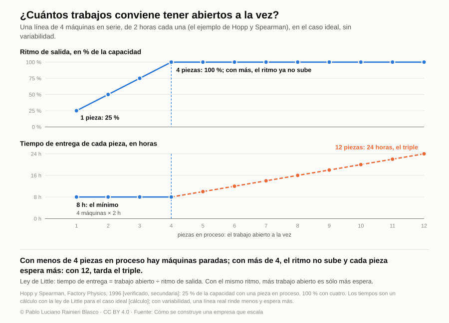

**A escala pequeña.** Un taller cuenta los trabajos empezados y no terminados. Si son muchos más que puestos de trabajo, deja de empezar trabajos nuevos hasta cerrar algunos. Si son menos que los puestos, o hay esperas por terceros, abre más, no menos.

#### G2 · Al 100 % de ocupación, la espera explota

**Regla.** **Con llegadas variables, la espera crece como ocupación ÷ (1 − ocupación): al 80 % es 4, al 90 % es 9 y al 95 % es 19. Hay que dejar capacidad libre a propósito.**

**Caso.** Bagust, Place y Posnett simularon un hospital: por encima del 85 % de camas ocupadas aparece el riesgo de no poder internar a un paciente urgente, y por encima del 90 % las crisis de camas son regulares `[verificado, secundaria — *BMJ*, 1999]`.

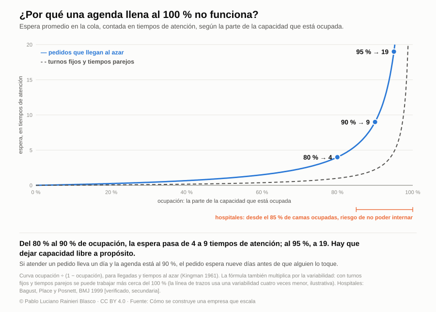

**Fuente.** J. F. C. Kingman, «The single server queue in heavy traffic», *Proceedings of the Cambridge Philosophical Society*, 57, 1961.

**Cuándo falla.** El umbral depende del tamaño y de la variabilidad, no es universal. Proudlove (2020) llama «falacia» al 85 % usado como número fijo: una unidad grande, o con llegadas programadas, puede operar más alto sin colas, porque la fórmula de Kingman también multiplica por la variabilidad. Con turnos fijos y tiempos parejos, se puede trabajar cerca del 100 %.

**A escala pequeña.** Un taller que acepta trabajos hasta llenar el 100 % de su agenda tiene esperas que crecen sin control ante el primer imprevisto. Conviene dejar uno de cada cinco turnos libre para urgencias o, mejor, dar turnos fijos que bajen la variabilidad.

#### G3 · La ley de Amdahl

**Regla.** **Acelerar una parte acelera el todo sólo en proporción a esa parte: si el 40 % del trabajo no se puede acelerar, el todo nunca va más de 2,5 veces más rápido.**

**Caso.** En 1967, Gene Amdahl estimó que las tareas de administración de datos, que se hacen paso por paso, ocupaban el 40 % de las instrucciones en producción, y argumentó contra multiplicar procesadores `[verificado, secundaria — Amdahl 1967, vía resúmenes]`.

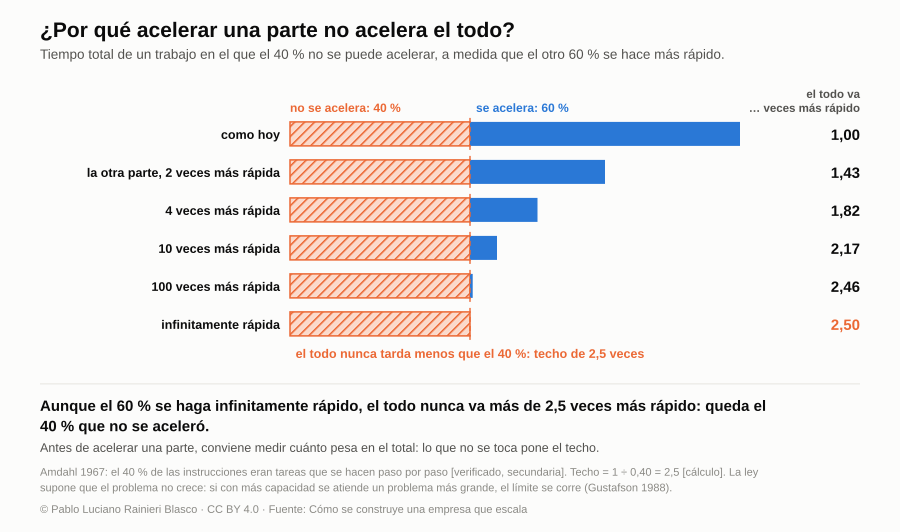

**Fuente.** Gene Amdahl, «Validity of the single processor approach to achieving large scale computing capabilities», AFIPS, 1967.

**Cuándo falla.** La ley supone que el problema no crece. En 1988, John Gustafson, en Sandia, agrandó el problema junto con la máquina y obtuvo con 1.024 procesadores aceleraciones de entre 1.016 y 1.021 veces en tres aplicaciones reales `[verificado, secundaria — *Communications of the ACM*, 31(5), 1988]`. Si con más capacidad se atiende un problema más grande, el límite se corre.

**A escala pequeña.** En un local, comprar una segunda plancha no acelera la entrega si el cuello está en la caja. Antes de invertir, medir qué fracción del tiempo total ocupa el paso que se va a acelerar.

#### G4 · Estimar el orden de magnitud con lápiz

**Regla.** **Antes de medir o de pedir datos, estimar el orden de magnitud partiendo el problema en factores que se puedan adivinar razonablemente.**

**Caso.** En la prueba Trinity, el 16 de julio de 1945, Enrico Fermi soltó papelitos al paso de la onda expansiva y estimó la potencia en unos 10 kilotones. El análisis radioquímico dio después 25 ± 2 kilotones: Fermi acertó el orden de magnitud, con un 40 % del valor, en un experimento de segundos `[verificado, primaria — Katz 2021]`.

**Fuente.** Enrico Fermi; el método se enseña como «problema de Fermi».

**Cuándo falla.** Si algún factor es incierto en varios órdenes de magnitud, el número único engaña. Sandberg, Drexler y Ord (2018) mostraron que, con las incertidumbres reales de cada factor de la ecuación de Drake, la probabilidad de estar solos en la galaxia no es despreciable, aunque el promedio sugiere millones de civilizaciones. Con factores muy inciertos se estima un rango, no un número.

**A escala pequeña.** Antes de abrir un local, estimar con lápiz: personas que pasan por día × fracción que entra × fracción que compra × ticket. Si un factor puede ser 1 % o 20 %, salir a medir ese factor primero.

### Las veintiséis reglas, en una línea

Para recortar y pegar al lado del escritorio:

| | Regla |
|---|---|
| A1 | Antes de abaratar una pieza, preguntar si tiene que existir, salvo que haya que separarla para reparar |
| A2 | Encadenar herramientas chicas para tener la respuesta hoy; integrar cuando el volumen lo pague |
| B1 | Mirar el contrato antes que el precio: con costo más honorario, gastar de más da ganancia |
| B2 | Si cada versión sólo suma requisitos, el costo crece más rápido que el presupuesto del cliente |
| B3 | Desarmar y costear el producto de quien ya lo hace, y sumarle lo que la pieza no muestra |
| B4 | Si el costo está en manipular, cambiar la unidad que se manipula |
| C1 | Si los datos publicados no coinciden con lo que se mide, medir uno mismo, con dos métodos |
| C2 | Si cada prueba es cara, probar todo junto, pero con cada parte ensayada antes en tierra |
| C3 | Si no se sabe qué camino funciona, financiar varios, con tope y con alguien que corte |
| C4 | Dibujar el proceso a tamaño real en el piso antes de construirlo |
| C5 | Mostrar lo mínimo para saber si alguien lo quiere, salvo donde el producto puede dañar |
| D1 | Preguntar qué haría quien nos reemplace, y qué sabemos que esa persona no sabría |
| D2 | Suponer que ya fracasó y escribir por qué, y desconfiar de la tranquilidad que deja el ejercicio |
| D3 | Estimar con lo que tardaron los proyectos parecidos, salvo que se esté cambiando la forma de hacerlo |
| D4 | Decidir con lo que falta gastar, no con lo ya gastado |
| E1 | Para lo urgente y nuevo, un equipo chico y separado, con el traspaso al negocio diseñado desde el día uno |
| E2 | Sumar gente al final atrasa; sumarla al principio, en tareas separables, adelanta |
| E3 | El producto copia la comunicación del equipo: para cambiar el producto, cambiar los equipos |
| E4 | Donde la falla es irreversible, no borrar el requisito: certificarlo con prueba física, no con papel |
| F1 | Una lista corta, leída en voz alta en los momentos críticos, y usada de verdad |
| F2 | Proteger a quien reporta el casi-error, y actuar sobre lo que reporta |
| F3 | Antes de recortar un costo, escribir qué error atrapaba y quién lo va a atrapar ahora |
| G1 | Menos trabajo abierto acorta la entrega, pero sólo mientras no baje el ritmo de salida |
| G2 | Dejar capacidad libre: al 90 % de ocupación la espera es más del doble que al 80 % |
| G3 | Acelerar una parte acelera el todo sólo en proporción a esa parte |
| G4 | Estimar el orden de magnitud con lápiz, y si un factor es muy incierto, medir ése primero |

---

## PARTE 12 — PRUEBA DE SALIDA

Para comprobar si el manual cumplió su objetivo: que quien lo leyó pueda **aplicarlo a un caso que no está en el texto**. Cinco preguntas; se aprueba con cuatro. Responder por escrito, sin volver a leer el libro. Después, con el libro abierto, buscar qué partes resuelven cada caso y corregirse. Si la corrección cambia más de una respuesta, conviene releer esas partes antes de aplicar el método a un negocio propio. **La clave no está en este documento, a propósito:** buscarla en el libro es parte de la prueba. Quien use el libro en un curso puede usar estas cinco preguntas como evaluación.

**1. La panadería.** Una persona vende tortas a 20 cada una. Los ingredientes cuestan 8. Cada torta le lleva hora y media, y el valor de mercado de su hora es 6. Sus costos fijos son 3.000 por mes y trabaja 160 horas por mes. Hoy vende 100 tortas por mes.
¿Tiene margen positivo por unidad? ¿Puede llegar a su punto de equilibrio vendiendo más? ¿Qué debería cambiar primero?

**2. El taller.** La primera unidad de un producto le llevó a un taller 100 horas. La octava, 51 horas. Un cliente pide cotización para 20 unidades y el dueño quiere cotizarlas a 10 horas cada una, «porque el costo va a seguir bajando».
¿Cuál es la tasa de aprendizaje del taller? ¿Es razonable la cotización? ¿Por qué?

**3. El anuncio.** Una empresa presenta así su plan: «Nuestro volante: más usuarios generan más datos, más datos mejoran el producto, un mejor producto atrae más usuarios. Por eso vamos a crecer solos».
¿Qué falta para creerlo? Nombrar al menos tres cosas.

**4. La fábrica de bicicletas.** Una empresa arma 40 bicicletas eléctricas por mes con piezas importadas. Quiere bajar el precio un 30 % construyendo una fábrica propia de cuadros y motores. La fábrica tardaría 14 meses en estar lista. Hoy pierde dinero cada mes y tiene caja para 8 meses. Nunca midió si su costo baja al duplicar la producción.
¿Qué controles fallan y en qué orden? ¿Cuál debería ser su peldaño 1?

**5. El inventor.** Una ingeniera diseñó un equipo que funciona mejor que todos los del mercado. En dos años vendió tres unidades. Dice: «Necesito inversión para mejorar el producto».
Diagnosticar con las seis funciones y con la prueba de los diez clientes. ¿Qué haría falta en su lugar?

---

## ANEXO A — LOS NÚMEROS Y SU ESTADO

**Ningún número sin su estado.** «Verificado» indica que el dato se contrastó con la fuente el 27 de septiembre o el 4 de octubre de 2026 (primaria: documento de la empresa, testimonio o artículo original; secundaria: una fuente confiable que la cita). «Reportado» indica que viene de biografías, prensa o informes y no se contrastó en esta revisión. El registro completo de las 91 afirmaciones del manual, con su estado, se lleva aparte.

| # | Número | Valor usado | Estado y fuente |
|-|-----------|----------|------------|
| 1 | Costo por kilo a órbita baja, transbordador espacial | ≈ US$54.500 | verificado, primaria — Jones 2018 |
| 2 | Costo por kilo a órbita baja, Falcon 9 | ≈ US$2.720 | verificado, primaria — Jones 2018; precio de lista sobre capacidad |
| 3 | Paquete de baterías de ion-litio, 2010 | más de US$1.100/kWh | reportado — BloombergNEF; la serie se reexpresa cada año en dólares constantes |
| 4 | Paquete de baterías de ion-litio, 2025 | US$108/kWh | verificado, primaria — BloombergNEF, encuesta de diciembre de 2025 |
| 5 | Tasa de aprendizaje de baterías | entre 12 y 30 % por duplicación, según el estudio | verificado, secundaria — Ziegler y Trancik 2021 y literatura citada ahí |
| 6 | Avión de pasillo único | ≈ US$50 millones, ~180 asientos, ~50.000 vuelos | orden de magnitud: ilustra el cociente, no es una contabilidad |
| 7 | Armado del chasis del Modelo T | de 12 h 30 min a 93 min (1913) | verificado, secundaria — Hounshell 1984 |
| 8 | Precio del Modelo T | US$850 (1908) → US$260 (1924-25) | verificado, secundaria; dólares corrientes |
| 9 | Ford, 1913: contrataciones y plantilla media | 50.448 y 13.623 (rotación ~370 %) | verificado, secundaria — The Henry Ford; Raff y Summers 1987 |
| 10 | Salario básico de Ford | US$2,34 → US$5 por día (enero de 1914) | verificado, secundaria — The Henry Ford |
| 11 | Venta de derechos del telar a Platt Brothers | £100.000, 21 de diciembre de 1929 | verificado, primaria — historia oficial de Toyota |
| 12 | NUMMI: trabajadores de la planta anterior | ~85 % | verificado, secundaria — Lean Enterprise Institute |
| 13 | NUMMI: ausentismo antes y después | ~20-25 % → ~2 % | verificado, secundaria — Lean Enterprise Institute |
| 14 | Aporte de Markkula a Apple | US$80.000 de capital + US$170.000 de préstamo | verificado, secundaria |
| 15 | Filosofía de marketing de Apple | documento de hacia 1977 | verificado, primaria — archivo de Steve Jobs |
| 16 | Precio de lanzamiento de la Lisa | US$9.995 (1983) | reportado |
| 17 | Resultado de Apple | −US$1.045 millones (1997); +US$309 millones (1998) | verificado, secundaria — informes anuales de Apple |
| 18 | Bonos convertibles de Amazon | 690 millones de euros ≈ US$681 millones (febrero de 2000) | verificado, primaria — informe anual de Amazon, 2000 |
| 19 | Primera ganancia anual de Amazon | US$35 millones (2003) | verificado, secundaria |
| 20 | Cargo contable por el teléfono de Amazon | US$170 millones (3.er trimestre de 2014) | verificado, secundaria — informe trimestral de Amazon |
| 21 | Vuelos del Falcon 1 | fallas en 2006, 2007 y ago-2008; éxito el 28-sep-2008 | reportado |
| 22 | Contrato de la NASA con SpaceX | 12 vuelos, ~US$1.600 millones (23-dic-2008) | verificado, secundaria — NASA |
| 23 | Ronda de Tesla | ~US$40 millones en deuda convertible (24-dic-2008) | verificado, secundaria |
| 24 | Kistler Aerospace | quiebra en julio de 2003 tras reunir ~US$900 millones | verificado, secundaria — SpaceNews |
| 25 | Duplicaciones para bajar a 1/10 del costo | 6,5 (r = 30 %) a 21,8 (r = 10 %) | cálculo — §3.3 |
| 26 | Ganancia del lazo del ejemplo | G ≈ 0,48, amplificación ≈ 1,9 | cálculo — modelo simplificado, §3.4 |
| 27 | Moneda con 60 % de acierto | Kelly = 20 %; apostar todo: 0,6 % de seguir en juego tras 10 tiradas | cálculo — §3.5 |
| 28 | Un millón / mil millones de segundos | 11,6 días / 31,7 años | cálculo |
| 29 | Desarrollo del Falcon 9 según la NASA (NAFCOM) | US$3.977 M / 1.695 M (costo más honorario); 1.383 M / 443 M (datos corregidos: costo más honorario / precio fijo) | verificado, primaria — NASA 2011; dólares de 2010; la tabla del anexo de la fuente suma 1.659, no 1.695 |
| 30 | Desarrollo del Falcon 9 declarado por SpaceX | ≈ US$300 M (≈ 390 con el Falcon 1) | verificado, secundaria — NASA 2010, citado por Zapata 2017; dato de la empresa |
| 31 | Actuador del Falcon 1 | US$120.000 cotizado → US$5.000 de presupuesto → US$3.900 | reportado — Vance 2015; una sola fuente |
| 32 | Challenger: temperatura al despegar y lanzamiento previo más frío | 2 °C; anillos de sellado a 12 °C | verificado, primaria — Comisión Rogers 1986 |
| 33 | XP-80 | 143 días de diseño y construcción (1943) | verificado, primaria — Lockheed Martin |
| 34 | Mil personas que apuestan todo a una moneda del 60 % | ≈ 6 siguen en juego a las 10 tiradas (1.000 × 0,6¹⁰); ninguna a las 100. Con el 20 %: mediana ≈ ×7,5 a las 100 (1,2⁶⁰ × 0,8⁴⁰) | cálculo — §3.5 |

**Advertencia de fuentes.** Los casos de empresas provienen de informes de las empresas, prensa, biografías e historia académica, no de auditorías propias. Ninguna conclusión de este manual depende de que un número puntual sea exacto: los mecanismos son estructurales y resisten un error del 50 % en cualquiera de ellos. Si alguno no lo resistiera, sería un defecto del manual y habría que corregirlo.

## ANEXO B — FUENTES, POR CAMPO

**Gestión de operaciones y aprendizaje organizacional.** Wright, T. P. (1936). Factors Affecting the Cost of Airplanes. *Journal of the Aeronautical Sciences*, 3(4), 122-128 · Abernathy, W. J. y Wayne, K. (1974). Limits of the Learning Curve. *Harvard Business Review*, 52(5) · Dutton, J. M. y Thomas, A. (1984). Treating Progress Functions as a Managerial Opportunity. *Academy of Management Review*, 9(2), 235-247 · Argote, L. y Epple, D. (1990). Learning Curves in Manufacturing. *Science*, 247(4945), 920-924 · Krafcik, J. F. (1988). Triumph of the Lean Production System. *Sloan Management Review*, 30(1) · Womack, J. P., Jones, D. T. y Roos, D. (1990). *The Machine That Changed the World* · Adler, P. S. (1993). Time-and-Motion Regained. *Harvard Business Review*, 71(1) · Shook, J. (2010). How to Change a Culture: Lessons from NUMMI. *MIT Sloan Management Review*, 51(2), 63-68 · Ohno, T. (1988). *Toyota Production System: Beyond Large-Scale Production* (original japonés de 1978) · Shewhart, W. A. (1931). *Economic Control of Quality of Manufactured Product* · Deming, W. E. (1986). *Out of the Crisis* · Goldratt, E. M. (1984). *La meta* · Miles, L. D. (1961). *Techniques of Value Analysis and Engineering* · Cooper, R. y Slagmulder, R. (1997). *Target Costing and Value Engineering* · Boothroyd, G., Dewhurst, P. y Knight, W. (2002). *Product Design for Manufacture and Assembly*, 2.ª ed., cap. 1 y 2 (el caso NCR, §1.5.4).

**Economía de la innovación y de la tecnología.** Arrow, K. J. (1962). The Economic Implications of Learning by Doing. *Review of Economic Studies*, 29(3) · Nagy, B., Farmer, J. D., Bui, Q. M. y Trancik, J. E. (2013). Statistical Basis for Predicting Technological Progress. *PLoS ONE*, 8(2) · Ziegler, M. S. y Trancik, J. E. (2021). Re-examining Rates of Lithium-Ion Battery Technology Improvement and Cost Decline. *Energy & Environmental Science*, 14, 1635-1651 · Way, R., Ives, M. C., Mealy, P. y Farmer, J. D. (2022). Empirically Grounded Technology Forecasts and the Energy Transition. *Joule*, 6(9) · BloombergNEF (2025). *Lithium-Ion Battery Pack Price Survey* · Jones, H. W. (2018). The Recent Large Reduction in Space Launch Cost. *48th International Conference on Environmental Systems*, ICES-2018-81.

**Economía industrial, información y finanzas.** Akerlof, G. A. (1970). The Market for «Lemons». *Quarterly Journal of Economics*, 84(3) · Spence, M. (1973). Job Market Signaling. *Quarterly Journal of Economics*, 87(3) · Kremer, M. (1993). The O-Ring Theory of Economic Development. *Quarterly Journal of Economics*, 108(3) · Kelly, J. L. (1956). A New Interpretation of Information Rate. *Bell System Technical Journal*, 35(4) · Petersen, M. A. y Rajan, R. G. (1997). Trade Credit: Theories and Evidence. *Review of Financial Studies*, 10(3).

**Historia empresarial.** Chandler, A. D. (1990). *Scale and Scope: The Dynamics of Industrial Capitalism* · Hounshell, D. A. (1984). *From the American System to Mass Production, 1800-1932* · Raff, D. M. G. y Summers, L. H. (1987). Did Henry Ford Pay Efficiency Wages? *Journal of Labor Economics*, 5(4) · Ford, H. (1922). *My Life and Work* · Sloan, A. P. (1964). *My Years with General Motors* · Toyota Motor Corporation. *75 Years of Toyota* (historia oficial).

**Estrategia, crecimiento y dinámica de sistemas.** Porter, M. E. (1985). *Competitive Advantage* · Greiner, L. E. (1972). Evolution and Revolution as Organizations Grow. *Harvard Business Review*, 50(4) · Churchill, N. C. y Lewis, V. L. (1983). The Five Stages of Small Business Growth. *Harvard Business Review*, 61(3) · Levie, J. y Lichtenstein, B. B. (2010). A Terminal Assessment of Stages Theory. *Entrepreneurship Theory and Practice*, 34(2), 317-350 · Sterman, J. D. (2000). *Business Dynamics: Systems Thinking and Modeling for a Complex World*.

**Método: qué se puede aprender de casos de éxito.** Denrell, J. (2003). Vicarious Learning, Undersampling of Failure, and the Myths of Management. *Organization Science*, 14(3), 227-243 · Rosenzweig, P. (2007). *The Halo Effect* · Resnick, B. G. y Smunt, T. L. (2008). From Good to Great to... *Academy of Management Perspectives*, 22(4) · Niendorf, B. y Beck, K. (2008). Good to Great, or Just Good? *Academy of Management Perspectives*, 22(4) · Siggelkow, N. (2007). Persuasion with Case Studies. *Academy of Management Journal*, 50(1) · Mayer, R. E. (2009). *Multimedia Learning* (2.ª ed.).

**Fuentes sobre las empresas.** Isaacson, W. (2011). *Steve Jobs* · Wozniak, S. (2006). *iWoz* · Markkula, M. (hacia 1977). *The Apple Marketing Philosophy*, archivo de Steve Jobs · Bryar, C. y Carr, B. (2021). *Working Backwards* · Bezos, J. Cartas a los accionistas de Amazon, 1997 y 2015 · Amazon.com. Informe anual 10-K405, 2000 · Collins, J. (2019). *Turning the Flywheel* (el concepto; *Good to Great*, 2001, no se usa como evidencia por las críticas citadas arriba) · Isaacson, W. (2023). *Elon Musk* · Toyoda, A. (2010). Testimonio ante el Comité de Supervisión de la Cámara de Representantes de EE. UU., 24 de febrero · NASA (2011). *Falcon 9 Launch Vehicle NAFCOM Cost Estimates*, agosto · Zapata, E. (2017). *An Assessment of Cost Improvements in the NASA COTS/CRS Program and Implications for Future NASA Missions*, AIAA Space 2017 · Vance, A. (2015). *Elon Musk* · Berger, E. (2021). *Liftoff* · Presidential Commission on the Space Shuttle Challenger Accident (1986). *Report* («Comisión Rogers»).

**Cómo se aprende (el método de los acertijos).** Kornell, N., Hays, M. J. y Bjork, R. A. (2009). Unsuccessful Retrieval Attempts Enhance Subsequent Learning. *Journal of Experimental Psychology: Learning, Memory, and Cognition*, 35(4), 989-998 · Richland, L. E., Kornell, N. y Kao, L. S. (2009). The Pretesting Effect: Do Unsuccessful Retrieval Attempts Enhance Learning? *Journal of Experimental Psychology: Applied*, 15(3), 243-257.

**Parte 11.** Las fuentes originales de cada ficha se nombran en la ficha; lo que se leyó para verificarlas está en el Anexo C.

## ANEXO C — FUENTES LEÍDAS PARA LA PARTE 11

Cómo leer: cada línea es lo que se abrió para verificar la ficha. Cuando la ficha dice «secundaria», el original no se leyó y se leyó una fuente que lo cita. El libro de Boothroyd, Dewhurst y Knight (ficha A1) se cita por edición y sección, en el Anexo B.

- **A1.** Reuters, vía https://www.collisionrepairmag.com/news/recycling/article/15730596/gone-too-soon-high-repair-cost-driving-many-teslas-to-salvage-prematurely-reuters-says y https://www.kbb.com/car-news/insurers-are-writing-off-lightly-damaged-teslas/ · estudio de 2025 (Thatcham Research), vía https://www.collisionrepairmag.com/business/processes/article/15767936/tesla-mega-casting-tesla-tech-cuts-repair-costs-research-firm-finds y https://www.repairerdrivennews.com/2025/09/18/study-on-tesla-model-y-finds-mega-casting-can-lower-repair-costs/ · Reuters, texto completo vía https://www.insurancejournal.com/news/national/2023/01/27/704879.htm
- **A2.** https://cs61.seas.harvard.edu/site/pdf/p471-bentley.pdf (*Communications of the ACM*, 29(6), junio de 1986; otra copia: https://www.cs.tufts.edu/~nr/cs257/archive/don-knuth/pearls-2.pdf)
- **B1.** https://www.nasa.gov/wp-content/uploads/2015/01/586023main_8-3-11_NAFCOM.pdf · https://breakingdefense.com/2023/04/boeing-hit-with-fresh-245-million-kc-46a-charge-erasing-defense-sectors-q1-profits/
- **B2.** https://www.csis.org/analysis/updating-augustines-law-fighter-aircraft-cost-growth-age-ai-and-autonomy · https://en.wikipedia.org/wiki/Augustine%27s_laws · https://news.lockheedmartin.com/2019-10-29-Pentagon-and-Lockheed-Martin-Reach-Agreement-Reducing-F-35A-Cost-by-12-8-Percent
- **B3.** https://electrek.co/2018/07/16/tesla-model-3-teardown-profitability/ · https://www.sec.gov/Archives/edgar/data/0001318605/000156459018024902/tsla-ex991_6.htm
- **B4.** https://worksthatwork.com/2/intermodal-container (texto de Levinson) · https://en.wikipedia.org/wiki/Malcom_McLean (cita a *The New York Times*, 25-nov-1986)
- **C1.** https://www.grc.nasa.gov/www/k-12/airplane/wrights/test1901.html · https://airandspace.si.edu/explore/stories/researching-wright-way · https://www.baltimoresun.com/1990/11/28/hubble-telescope-panel-says-maker-of-flawed-mirror-withheld-test-data/
- **C2.** https://www.nasa.gov/wp-content/uploads/2023/06/stages-to-saturn-sp-4206.pdf (cap. 12; antes en https://history.nasa.gov/SP-4206/ch12.htm) · http://www.astronautix.com/n/n1.html
- **C3.** https://en.wikipedia.org/wiki/Manhattan_Project · https://blog.nuclearsecrecy.com/2013/05/17/the-price-of-the-manhattan-project/ · https://en.wikipedia.org/wiki/Soviet_crewed_lunar_programs · https://www.nasa.gov/wp-content/uploads/static/history/SP-4408pt1.pdf
- **C4.** https://en.wikipedia.org/wiki/History_of_McDonald's (cita a Hess 1986) · https://www.pbssocal.org/food-living/the-real-mcdonalds-the-san-bernardino-origins-of-a-fast-food-empire
- **C5.** https://kirjonen.me/how-dropbox-got-75000-wait-list-signups-from-digg/ · https://www.liu.edu/~/media/RedesignFiles/LIU%20Main%20Page/Polk/2015_Finance_TheWallStreetJournal.pdf
- **D1.** https://semiwiki.com/semiconductor-manufacturers/intel/2948-revisiting-andy-groves-only-the-paranoid-survive/ · https://www.trendforce.com/news/2026/08/21/news-intel-and-memory-a-history-of-exits-and-a-new-bid-to-return/ (anuncio de octubre de 1985) · https://www.jckonline.com/editorial-article/jc-penney-lost-nearly-1-billion-in-2012/
- **D2.** https://corporate.jasoncollins.blog/premortem
- **D3.** https://budgetoverrun.com/studies/flyvbjerg-megaproject-database · https://www.mckinsey.com/capabilities/strategy-and-corporate-finance/our-insights/daniel-kahneman-beware-the-inside-view
- **D4.** https://en.wikipedia.org/wiki/Concorde · https://link.springer.com/article/10.3758/s13420-011-0055-1 (cita a Dawkins y Carlisle 1976 y a Arkes y Ayton 1999)
- **E1.** https://www.lockheedmartin.com/en-us/who-we-are/business-areas/aeronautics/skunkworks/skunk-works-origin-story.html · https://en.wikipedia.org/wiki/Xerox_Star · https://www.computerhistory.org/revolution/input-output/14/348
- **E2.** https://en.wikipedia.org/wiki/The_Mythical_Man-Month · https://stevemcconnell.com/articles/brooks-law-repealed/
- **E3.** https://www.sciencedirect.com/science/article/abs/pii/S0048733312001205 · https://www.hbs.edu/ris/Publication%20Files/08-039_1861e507-1dc1-4602-85b8-90d71559d85b.pdf · https://www.hbs.edu/ris/download.aspx?name=16-124.pdf
- **E4.** https://sma.nasa.gov/docs/default-source/safety-messages/safetymessage-2006-06-01-ussthresherlessonslearned-vits.pdf · https://direct.mit.edu/books/oa-monograph/chapter-pdf/2280545/9780262298247_car.pdf · https://democrats-transportation.house.gov/imo/media/doc/2020.09.15%20FINAL%20737%20MAX%20Report%20for%20Public%20Release.pdf
- **F1.** https://news.harvard.edu/gazette/story/2009/01/surgical-safety-checklist-drops-deaths-and-complications-by-more-than-one-third/ · https://pubmed.ncbi.nlm.nih.gov/24620866/ · https://aviation-safety.net/wikibase/83555 · https://en.wikipedia.org/wiki/Boeing_Model_299
- **F2.** https://skybrary.aero/articles/aviation-safety-reporting-system-asrs · https://ntrs.nasa.gov/api/citations/20240013579/downloads/ASRS%20GA%20Outreach.pdf · https://en.wikipedia.org/wiki/Columbia_Accident_Investigation_Board · https://govinfo.library.unt.edu/caib/events/press_briefings/20030520/transcript.html
- **F3.** https://en.wikipedia.org/wiki/Faster,_better,_cheaper · https://en.wikipedia.org/wiki/Mars_Surveyor_%2798 · https://nssdc.gsfc.nasa.gov/planetary/text/nasa_pr_20000328.txt (informe Young)
- **G1.** https://ideas.repec.org/a/inm/oropre/v9y1961i3p383-387.html · https://kanban.university/resources/casestudies/xit/ · http://images.itrevolution.com/images/kanbans/From_Worst_to_Best_in_9_Months_Final_1_3-aw.pdf · https://tamcam.tamu.edu/courses/inen220/Handouts/factory.pdf
- **G2.** https://www.mja.com.au/journal/2010/192/1/myths-ideal-hospital-occupancy (cita a Bagust 1999) · https://journals.sagepub.com/doi/10.1177/0951484819870936
- **G3.** https://en.wikipedia.org/wiki/Amdahl%27s_law · https://dl.acm.org/doi/pdf/10.1145/42411.42415 · https://cis.temple.edu/~shi/wwwroot/shi/public_html/docs/amdahl/amdahl.html
- **G4.** https://arxiv.org/abs/2103.05784 · https://arxiv.org/abs/1806.02404

---

## RESUMEN EN UN PÁRRAFO

Una empresa que escala es un producto de seis funciones —entender al cliente, definir el producto, producir con calidad, vender, financiar y organizar— y si una vale cero, todo vale cero; por eso Apple necesitó a un ingeniero, a alguien que viera el producto y a alguien que pusiera el capital y el método comercial. Después vienen cinco cuentas: encontrar la unidad que se repite, asegurarse de que cada unidad deje dinero con la hora propia al costo, medir cuánto baja el costo cada vez que se duplica la producción —porque esa tasa, y no el entusiasmo, decide si el sueño está a 88 veces de volumen o a cuatro millones—, comprobar con números si el lazo entre costo, precio y demanda amplifica, y calcular la profundidad y el ancho del pozo antes de caer adentro. Ford enseña el flujo y el precio objetivo, y también el costo de la rigidez; Toyota, que la calidad se hace en el proceso y que crecer más rápido que ella la rompe; Apple, el foco y que el cliente paga lo que percibe; Amazon, que el cliente puede financiar el crecimiento y que el colchón se consigue antes de necesitarlo; SpaceX, que se diseña hacia atrás desde el número final y que reutilizar cambia el denominador. Los cinco estuvieron cerca de fracasar al menos una vez, y por cada uno hay otros que hicieron algo parecido y desaparecieron. Nada de esto garantiza el resultado —que depende de factores que nadie controla—, pero todo es público, se verifica con lápiz y funciona igual en una fábrica de autos que en un taller: no da la magnitud, da la pendiente, y a escala pequeña la pendiente es lo único que importa.

---

## COLOFÓN

**Autor:** Pablo Luciano Rainieri Blasco.

**Cómo citar este libro:** Rainieri Blasco, P. L. (2026). *Cómo se construye una empresa que escala* (versión 2.0). Licencia CC BY 4.0.

**Licencia.** Este libro se publica bajo la licencia Creative Commons Atribución 4.0 Internacional (CC BY 4.0): https://creativecommons.org/licenses/by/4.0/deed.es. Se puede copiar, redistribuir, traducir, adaptar y usar con cualquier fin, incluso comercial, con tres condiciones: citar al autor, enlazar la licencia e indicar si se hicieron cambios. Las figuras se publican bajo la misma licencia. Las citas textuales de terceros, los datos de las fuentes y las marcas que se mencionan pertenecen a sus titulares y no quedan cubiertos por esta licencia.

**Cómo se hizo.** Los números del libro se calcularon o se contrastaron con sus fuentes, y cada uno lleva su estado. Los casos de empresas vienen de informes de las propias empresas, de la prensa, de biografías y de historia académica, no de auditorías propias. La redacción y la verificación de fuentes se hicieron con asistencia de un modelo de inteligencia artificial (Claude, de Anthropic), bajo la dirección y la revisión del autor.

**Errores.** Un libro que pide marcar el estado de cada número tiene que aceptar que le marquen los suyos. Toda corrección con fuente es bienvenida, y la versión siguiente la incorpora con su fecha.

**Versión 2.0, octubre de 2026.** Respecto de la 1.1 (septiembre de 2026): portada y acertijos, el mapa del libro, cuarenta y tres figuras, el caso «Quién gana si el costo sube» (NASA 2011), la receta R9 «El índice idiota», la Parte 11 con veintiséis lecciones de otras industrias, la Parte 12 adaptada a un lector sin docente y el Anexo C.
